# ☁️ CloudOps 360

### A Multi-Service DevOps and Cloud Infrastructure Project

<p align="center">
  
  
  
  
  
  
  
</p>

<p align="center">
  <b>A practical implementation connecting application development, CI/CD automation, containerisation, Kubernetes, infrastructure as code, AWS and monitoring.</b>
</p>

---

## 🏗️ CloudOps 360 Architecture

The following diagram illustrates the end-to-end workflow of CloudOps 360, covering application services, CI/CD automation, containerization, Kubernetes deployment, AWS infrastructure, and monitoring.

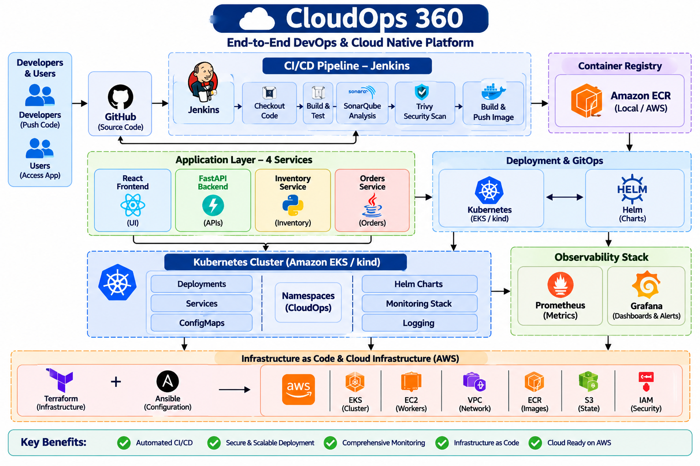

---

## 📑 Table of Contents

1. [Project Overview](#-project-overview)
2. [Project Objectives](#-project-objectives)
3. [Technology Stack](#-technology-stack)
4. [Application Architecture](#-application-architecture)
5. [End-to-End Project Workflow](#-end-to-end-project-workflow)
6. [Jenkins CI/CD Pipeline](#-jenkins-cicd-pipeline)
7. [Docker and Kubernetes](#-docker-and-kubernetes)
8. [Helm and GitOps Configuration](#-helm-and-gitops-configuration)
9. [Infrastructure as Code and AWS](#-infrastructure-as-code-and-aws)
10. [Monitoring and Observability](#-monitoring-and-observability)
11. [Security and Quality Checks](#-security-and-quality-checks)
12. [Testing and Verification](#-testing-and-verification)
13. [Project Screenshots](#-project-screenshots)
14. [Installation and Setup](#-installation-and-setup)
15. [Repository Structure](#-repository-structure)
16. [Security Considerations](#-security-considerations)
17. [Current Limitations](#-current-limitations)
18. [Learning Outcomes](#-learning-outcomes)
19. [Additional Documentation](#-additional-documentation)
20. [Author](#-author)

---

## 🚀 Project Overview

CloudOps 360 is a hands-on, multi-service application and DevOps project developed to explore how modern application development and deployment workflows can be organised using commonly used DevOps and cloud technologies.

The project combines four application components with a shared Jenkins pipeline, Docker containerisation, Kubernetes deployment configuration, infrastructure automation and monitoring.

The application consists of:

- A React frontend.
- A Python FastAPI backend.
- A separate Python FastAPI Inventory service.
- A Java Spring Boot Orders service.

The DevOps implementation brings together Git and GitHub for source control, Jenkins for CI/CD, SonarQube for code-quality analysis, Trivy for security scanning, Docker for container images, and Kubernetes and Helm for deployment configuration.

Terraform and Ansible configuration are maintained for infrastructure and server automation. Selected AWS resources have also been inspected in the Mumbai region.

Prometheus and Grafana are used for metrics monitoring and dashboard visualisation.

### Key Project Components

| Area | Implementation |
|---|---|
| Application | React, FastAPI, Spring Boot |
| Source control | Git and GitHub |
| CI/CD | Jenkins shared pipeline |
| Code quality | SonarQube |
| Security scanning | Trivy |
| Containerisation | Docker |
| Container registry | Local registry and Amazon ECR |
| Orchestration | Kubernetes |
| Deployment packaging | Helm |
| Infrastructure as Code | Terraform |
| Configuration management | Ansible |
| Cloud platform | AWS |
| Monitoring | Prometheus and Grafana |
| Local automation | PowerShell |

**Project scope:** This is a learning and portfolio implementation. Configuration, execution and verification are distinguished throughout this README. A component being present in the repository does not automatically mean every integration or deployment path is active.

---

## 🎯 Project Objectives

The main objectives of CloudOps 360 are:

1. Develop and organise a multi-service application.
2. Understand source-code management using Git and GitHub.
3. Create a reusable Jenkins pipeline for multiple application services.
4. Automate application builds and unit-test execution.
5. Integrate SonarQube for code-quality analysis.
6. Use Trivy to scan dependencies and container images.
7. Build and manage Docker images.
8. Understand Kubernetes workloads and container orchestration.
9. Manage deployment configuration using Helm.
10. Maintain environment-specific Kubernetes and GitOps configuration.
11. Explore infrastructure provisioning through Terraform.
12. Work with Ansible playbooks for server configuration.
13. Gain practical exposure to AWS infrastructure.
14. Inspect application and infrastructure metrics through Prometheus and Grafana.
15. Troubleshoot issues across application, CI/CD, container and infrastructure layers.

---

## 🧰 Technology Stack

### Application Development

| Technology | Purpose |
|---|---|
| React | Frontend user interface |
| TypeScript / JavaScript | Frontend application development |
| Python | Backend and Inventory service implementation |
| FastAPI | Backend API framework |
| Java | Orders service implementation |
| Spring Boot | Java application framework |
| Maven | Java build and test management |
| pytest | Python test framework |
| Vitest | Frontend test framework |

### DevOps and CI/CD

| Technology | Purpose |
|---|---|
| Git | Version control |
| GitHub | Source-code hosting |
| Jenkins | CI/CD automation |
| Jenkins Configuration as Code | Jenkins configuration |
| SonarQube | Static code analysis and quality gate |
| Trivy | Dependency and image vulnerability scanning |
| Docker | Container image creation and execution |
| Amazon ECR | Container image storage |

### Container Orchestration and Deployment

| Technology | Purpose |
|---|---|
| Kubernetes | Container orchestration |
| kind | Local Kubernetes cluster |
| kubectl | Kubernetes command-line management |
| Helm | Kubernetes application packaging and configuration |
| Argo CD configuration | GitOps application definitions and deployment configuration |

### Infrastructure and Cloud

| Technology | Purpose |
|---|---|
| Terraform | Infrastructure as Code |
| Ansible | Configuration-management playbooks |
| AWS EKS | Managed Kubernetes service |
| Amazon EC2 | Compute infrastructure |
| Amazon VPC | Network infrastructure |
| Amazon ECR | Container image repositories |
| Amazon S3 | Terraform state storage |
| AWS IAM | Identity and access management |
| AWS CLI | AWS command-line operations |
| PowerShell | Windows automation |
| Linux | Server and command-line environment |

### Monitoring

| Technology | Purpose |
|---|---|
| Prometheus | Metrics collection |
| Grafana | Monitoring dashboards |
| ServiceMonitor configuration | Prometheus target discovery configuration |

---

## 🖥️ Application Architecture

CloudOps 360 is organised into four main application components.

### 1. Frontend – React

The frontend provides the user-facing application interface.

Its responsibilities include:

- Rendering application pages and components.
- Communicating with backend APIs.
- Displaying application information.
- Providing an interface for user interactions.

The frontend has its own Dockerfile and is included in the shared Jenkins pipeline.

### 2. Backend – FastAPI

The backend is implemented using Python and FastAPI.

Its responsibilities include:

- Exposing API endpoints.
- Handling application requests.
- Managing application configuration.
- Providing backend functionality.
- Reporting diagnostic information about configured integrations.
- Integrating with selected external services through dedicated integration modules.

The backend also includes API, parser and security tests.

### 3. Inventory Service – FastAPI

The Inventory service is a separate Python-based service.

It has its own application code, Dockerfile, dependencies and pytest test suite.

The separate service structure provides an opportunity to work with independently built and tested application components.

### 4. Orders Service – Spring Boot

The Orders service is implemented using Java and Spring Boot.

It includes:

- Order-related API functionality.
- An inventory client integration.
- Request and exception-handling components.
- Version information.
- Chaos-related application components and tests.

Maven is used for build and test execution. This service also has a SonarQube analysis stage in the Jenkins pipeline.

### Logical Application Structure

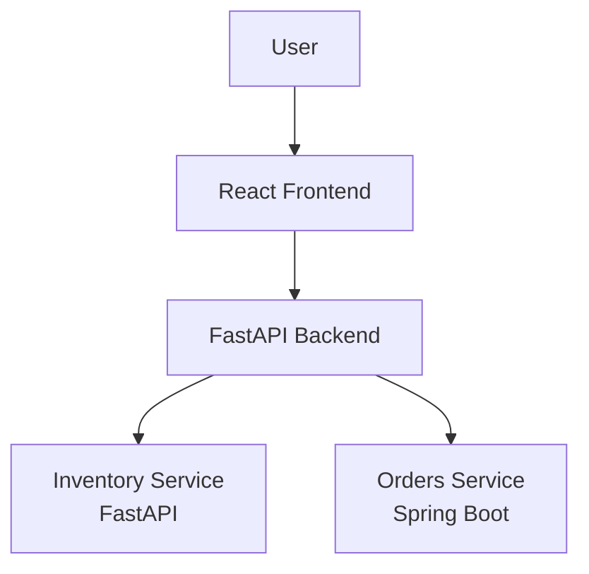

This is a logical overview of the application components, not a claim that every possible service-to-service route has been independently verified.

---

## 🔄 End-to-End Project Workflow

The project covers multiple stages of the DevOps lifecycle, from source-code management to application packaging, deployment configuration and monitoring.

### High-Level Workflow

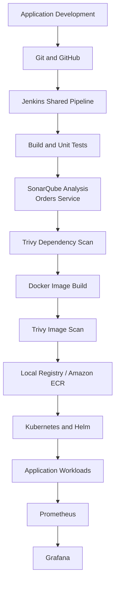

The diagram describes the configured toolchain. The SonarQube stage is conditional and runs only for the Orders service. GitOps updates and Kubernetes rollout checks are optional pipeline parameters.

### Workflow Stages

| Stage | Description |
|---|---|
| Source management | Maintain application code in GitHub |
| CI/CD | Jenkins checks out the repository and selects the application |
| Build and testing | Run the relevant build and unit tests |
| Code quality | Execute SonarQube analysis for the Orders service |
| Dependency scanning | Scan application files and dependencies using Trivy |
| Containerisation | Build a Docker image with application version information |
| Image scanning | Scan the built container image using Trivy |
| Image publishing | Push the image to the selected registry |
| Deployment configuration | Maintain Kubernetes and Helm configuration |
| Monitoring | Inspect metrics through Prometheus and Grafana |

---

## ⚙️ Jenkins CI/CD Pipeline

Jenkins is used as the CI/CD automation server.

The project uses a **single shared Jenkinsfile** to support four application jobs. The job name determines which application is selected.

### Shared Pipeline Jobs

| Jenkins job | Application directory | Build type |
|---|---|---|
| `orders-service` | `apps/orders-service` | Java / Maven |
| `inventory-service` | `apps/inventory-service` | Python / pytest |
| `cloudops-backend` | `apps/backend` | Python / pytest |
| `cloudops-frontend` | `apps/frontend` | Node.js / Vitest |

### Pipeline Architecture

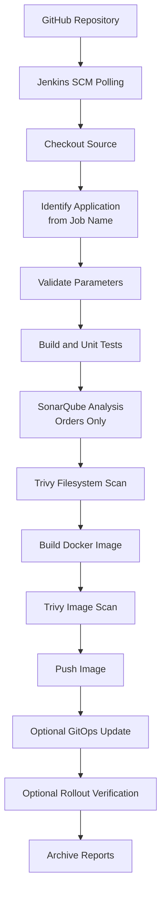

### Pipeline Stages

**1. Validate parameters**

The pipeline validates the selected application, registry, GitOps environment and Trivy severity configuration.

**2. Checkout**

Jenkins checks out the source repository and identifies the Git commit.

A versioned image tag is generated using the short Git commit hash and Jenkins build number.

**3. Change detection**

For SCM-triggered builds, the pipeline checks whether changes affect the selected application directory or the Jenkins pipeline.

Unrelated application changes can be skipped. Manual builds are not skipped by this change-detection condition.

The Jenkinsfile uses SCM polling configured with:

```groovy
pollSCM('H/2 * * * *')
```

**4. Build and unit tests**

The pipeline selects the build process based on the application type.

| Application type | Build and test command |
|---|---|
| Java | `mvn -B -ntp verify` |
| Python | Create virtual environment, install development requirements and run pytest |
| Frontend | Install npm dependencies and run Vitest |

JUnit XML reports are collected by Jenkins.

**5. SonarQube analysis and quality gate**

SonarQube analysis is configured for the `orders-service` job.

The pipeline uses the configured SonarQube server and Jenkins credential, and waits for the quality-gate result.

This stage is conditional; it is not executed for all four jobs.

**6. Dependency security scan**

Trivy scans the application filesystem for vulnerabilities.

The pipeline generates a JSON report and applies a configurable vulnerability severity gate.

**7. Docker image build**

Docker builds an image for the selected application.

The image receives build arguments containing the generated application version and Git commit.

**8. Container image scan**

Trivy scans the newly built image.

The configured severity threshold determines whether the scan gate fails the build.

**9. Push image**

The image is pushed to the selected registry.

The pipeline supports a local registry and an Amazon ECR registry configuration. ECR authentication uses the AWS CLI when an ECR registry is selected.

**10. Update GitOps repository – optional**

When `UPDATE_GITOPS` is enabled, the pipeline clones the configured GitOps repository, updates the selected application's image tag, commits the change and pushes it to the `main` branch.

This step depends on the GitOps repository URL and Jenkins credentials being configured correctly.

**11. Verify rollout – optional**

When `VERIFY_ROLLOUT` is enabled, Jenkins checks the Kubernetes deployment image tag and runs a rollout-status check.

This requires a usable Kubernetes configuration inside Jenkins.

**12. Archive reports**

The pipeline archives available Trivy JSON reports and publishes JUnit test results.

### Jenkins Pipeline Options

| Parameter | Purpose |
|---|---|
| `REGISTRY` | Select local registry or ECR registry |
| `AWS_REGION` | AWS region when using ECR |
| `GITOPS_ENV` | Select GitOps environment directory |
| `TRIVY_GATE_SEVERITY` | Configure vulnerability severity threshold |
| `UPDATE_GITOPS` | Enable or disable GitOps image-tag update |
| `VERIFY_ROLLOUT` | Enable or disable Kubernetes rollout verification |

### Recorded Jenkins Verification

The Orders service pipeline completed successfully in **Build #16**, after a SonarQube credential issue was resolved.

This is recorded evidence of a successful Orders pipeline execution. It does not imply that every stage, every application job or every optional deployment path has been verified successfully.

---

## 🐳 Docker and Kubernetes

### Docker Containerisation

Docker is used to package the application components into container images.

Each application service has its own Dockerfile.

Containerisation provides:

- Consistent application packaging.
- Isolation between application components.
- Repeatable build environments.
- A standard image format for deployment.
- Easier movement of images between local and cloud registries.

### Kubernetes

Kubernetes is used for container orchestration and application workload management.

The project includes Kubernetes deployment configuration and local cluster workflows.

Common Kubernetes resources represented in the deployment configuration include:

| Resource | Purpose |
|---|---|
| Pod | Runs application containers |
| Deployment | Manages application replicas and updates |
| Service | Provides network access to selected pods |
| Namespace | Organises cluster resources |
| ConfigMap | Stores non-sensitive configuration |
| Secret | Stores sensitive configuration values |
| ServiceAccount | Provides an identity for workloads |
| HorizontalPodAutoscaler | Defines workload scaling configuration |
| ServiceMonitor | Defines monitoring target discovery configuration |

The actual resources available depend on the selected environment and the manifests applied to that cluster.

### Local Kubernetes

The repository includes a Windows script for creating a local Kubernetes cluster using kind.

```powershell
.\scripts\windows\02-create-cluster.ps1
```

Useful inspection commands:

```powershell
kubectl get nodes
kubectl get pods -A
kubectl get services -A
kubectl get deployments -A
```

### AWS Kubernetes

An AWS EKS cluster named `cloudops360` was observed in Active state during the recorded infrastructure inspection.

The cluster and its worker node are described in the AWS section below.

---

## 📦 Helm and GitOps Configuration

### Helm

Helm is used to organise Kubernetes application deployment configuration.

The repository contains charts for:

- Application deployment.
- Cluster configuration.
- Argo CD application definitions.
- Additional observability configuration.

The application chart includes Kubernetes templates for deployment, service, service account, RBAC, HPA and ServiceMonitor resources.

### GitOps Repository Layout

The main repository contains the deployment configuration under `gitops/`.

```text
gitops/
├── argocd/
│   ├── kube-prometheus-stack-local.yaml
│   ├── orders-first-local.yaml
│   ├── project.yaml
│   ├── root-app-aws.yaml
│   └── root-app-local.yaml
│
├── charts/
│   ├── argocd-apps/
│   ├── cloudops-app/
│   ├── cluster-config/
│   └── observability-extras/
│
└── envs/
    ├── aws/
    └── local/
```

Environment-specific manifests help keep local and AWS deployment configuration separate.

### GitOps Image Update Flow

The Jenkinsfile contains an optional GitOps update stage.

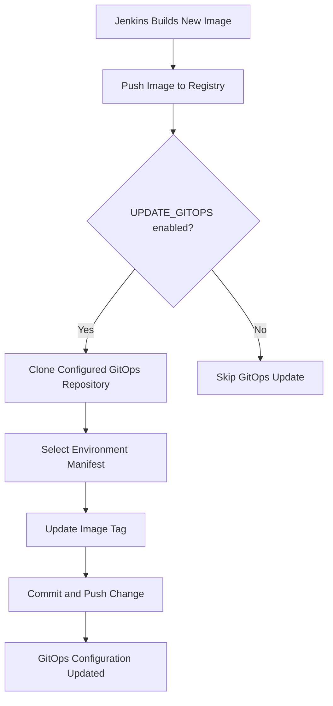

**Deployment status:** GitOps and Argo CD configuration is present in the repository. Active Argo CD installation and automatic reconciliation in the EKS cluster have not been verified. The presence of manifests should not be interpreted as proof of an active GitOps controller.

---

## ☁️ Infrastructure as Code and AWS

The project contains Terraform modules and Ansible playbooks for infrastructure and configuration-management activities.

Selected AWS resources associated with CloudOps 360 were inspected in the **Asia Pacific (Mumbai) region (`ap-south-1`)**.

### Terraform

Terraform configuration is organised into reusable infrastructure modules and environment-specific configuration.

The repository contains modules for:

- Networking.
- Amazon EKS.
- Amazon ECR.
- CI server infrastructure.
- Budget configuration.

Terraform is used to represent infrastructure as code, including variables, outputs and provider configuration.

The project also contains separate bootstrap, persistent and session environment directories.

Terraform state, plan files and variable files may contain sensitive infrastructure details and must not be published.

### Ansible

Ansible configuration is maintained under `infra/ansible/`.

The repository includes:

- Ansible configuration.
- Example inventory.
- Requirements file.
- Main playbook.
- Roles for common configuration, Docker, Java and CI stack setup.
- Templates and supporting files.

Ansible provides a structure for repeatable server configuration.

### AWS Resources Identified

| AWS service | Project usage | Recorded observation |
|---|---|---|
| Amazon EKS | Managed Kubernetes | `cloudops360` cluster observed Active |
| Amazon EC2 | Worker compute | EKS worker instance observed Running |
| Amazon VPC | Network infrastructure | Project VPC identified |
| Amazon ECR | Container image storage | Four application repositories identified |
| Amazon S3 | Terraform state storage | Project state bucket identified |
| AWS IAM | Access management | Project-related IAM roles identified |

### 1. Amazon EKS

An EKS cluster named `cloudops360` was observed in Active state during inspection.

| Property | Observed value |
|---|---|
| Cluster name | `cloudops360` |
| Region | `ap-south-1` |
| Status | Active at time of inspection |
| Kubernetes version | `1.36` |
| Managed node groups | 1 |

### 2. Amazon EC2

The EKS managed node group was observed with the following configuration:

| Property | Observed value |
|---|---|
| Node group | `default` |
| Instance type | `m7i-flex.large` |
| Desired capacity | 1 |
| Minimum capacity | 1 |
| Maximum capacity | 1 |
| Worker state | Running at time of inspection |

### 3. Amazon VPC

The project VPC was identified with the following properties:

| Property | Observed value |
|---|---|
| VPC name | `cloudops360` |
| CIDR block | `10.20.0.0/16` |
| Subnets | 2 |
| Internet Gateway | Attached |
| Region | `ap-south-1` |

### 4. Amazon ECR

Four application repositories were identified:

- `cloudops/cloudops-backend`
- `cloudops/cloudops-frontend`
- `cloudops/inventory-service`
- `cloudops/orders-service`

These repositories provide image storage for the project's application components.

### 5. Amazon S3

An S3 bucket is used for Terraform remote state storage.

The inspected configuration included:

- Bucket versioning enabled.
- Server-side encryption using SSE-S3.
- Terraform state objects stored in the bucket.

Terraform state should be treated as sensitive infrastructure data.

### 6. AWS IAM

Project-related IAM roles identified during inspection include:

- `cloudops360-cluster`
- `cloudops360-node`
- `cloudops360-backend-readonly`

These roles are associated with project infrastructure and access permissions.

### AWS Verification Notes

The AWS resources above were observed during inspection. This does not establish that every resource was provisioned through the current Terraform configuration or that the complete application has been deployed and exposed end to end through EKS.

AWS resources can incur charges while active. Review the environment and its costs before provisioning, modifying or retaining cloud resources.

---

## 📊 Monitoring and Observability

CloudOps 360 includes Prometheus and Grafana for metrics monitoring and visualisation.

### Prometheus

Prometheus is used for metrics collection from configured monitoring targets.

The project contains monitoring configuration, including Kubernetes monitoring manifests and ServiceMonitor templates.

Prometheus targets were inspected during project verification.

### Grafana

Grafana provides dashboards for visualising metrics collected by Prometheus.

A Grafana dashboard was inspected during verification.

### Monitoring Flow

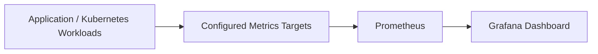

The metrics available depend on the targets and exporters configured in the environment.

**Scope note:** This README documents the Prometheus and Grafana monitoring path. It does not claim a fully verified alert-delivery workflow, centralised logging deployment or distributed tracing implementation.

---

## 🔐 Security and Quality Checks

Security and code-quality checks are included in the Jenkins pipeline.

### SonarQube

SonarQube is integrated into the Orders service pipeline.

It performs code analysis and waits for the configured quality-gate result.

### Trivy

Trivy is used at two points in the pipeline:

1. Filesystem scan to identify dependency vulnerabilities.
2. Container image scan to identify image vulnerabilities.

The pipeline supports a configurable severity threshold and uses the project's `.trivyignore` file.

### Jenkins Credentials

The pipeline references Jenkins-managed credentials for integrations such as SonarQube and GitOps repository access.

Credential values should be stored in Jenkins rather than hardcoded in the repository.

### Security Practices

- Keep credentials out of source code.
- Do not commit `.env` files or private keys.
- Keep Terraform state and plan files out of Git.
- Review staged files before committing.
- Use appropriate AWS IAM permissions.
- Protect Jenkins credentials.
- Restrict access to local development services.
- Review screenshots for exposed account identifiers, endpoints or other sensitive information.

---

## 🧪 Testing and Verification

Testing is used to validate application components and identify issues during development.

### Test Technologies

| Component | Testing tool |
|---|---|
| Backend | pytest |
| Inventory service | pytest |
| Frontend | Vitest |
| Orders service | Maven tests / JUnit |

### Recorded Test Results

| Component | Recorded result |
|---|---|
| Backend | Test suite executed successfully in recorded runs |
| Inventory service | 12 tests passed in a recorded run |
| Orders service | 13 tests, 0 failures and 0 errors in a recorded run |
| Jenkins Orders pipeline | Build #16 completed successfully |
| SonarQube | Integrated into the Orders pipeline |
| Kubernetes | Cluster and workload deployment activities performed |
| Prometheus | Monitoring targets inspected |
| Grafana | Dashboard inspected |
| AWS | Selected infrastructure resources inspected |

These are historical verification results. They are not a guarantee that every test will pass in a fresh environment. Re-run the test suites before treating them as current release results.

### Useful Test Commands

Backend:

```powershell
cd apps\backend
python -m pytest -q
```

Inventory service:

```powershell
cd apps\inventory-service
python -m pytest -q
```

Orders service:

```powershell
cd apps\orders-service
mvn test
```

Frontend:

```powershell
cd apps\frontend
npm install
npm test
```

---


## 📸 Project Screenshots

### Application Dashboard
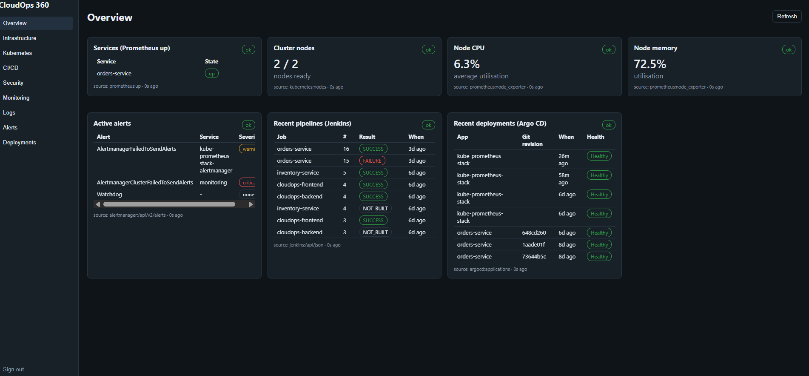

### CI/CD Pipeline – Jenkins


### Code Quality – SonarQube


### Kubernetes Workloads
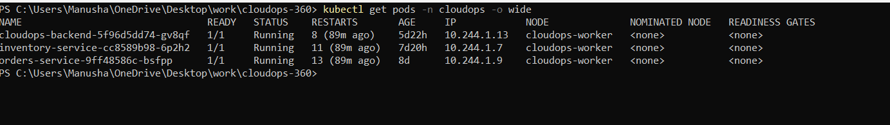

### Monitoring and Observability

**Prometheus Targets**


**Grafana Dashboard**

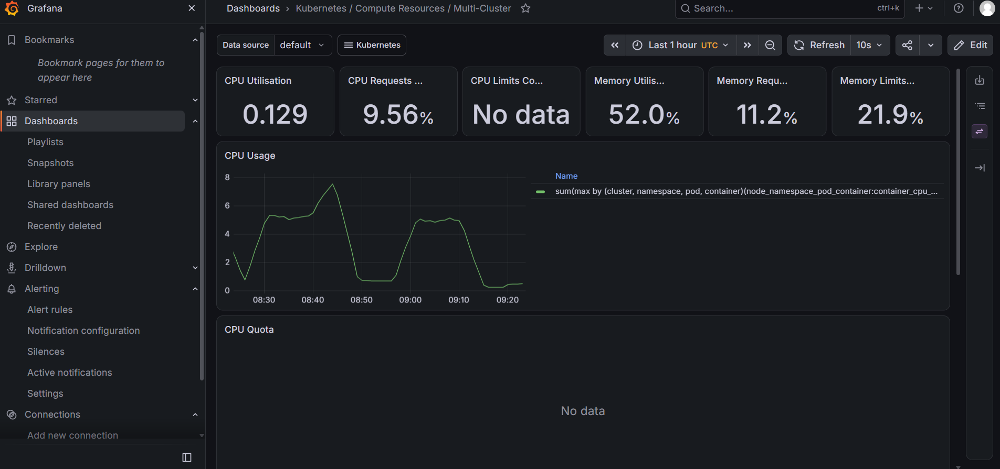

### AWS Infrastructure

**Amazon EKS Cluster**

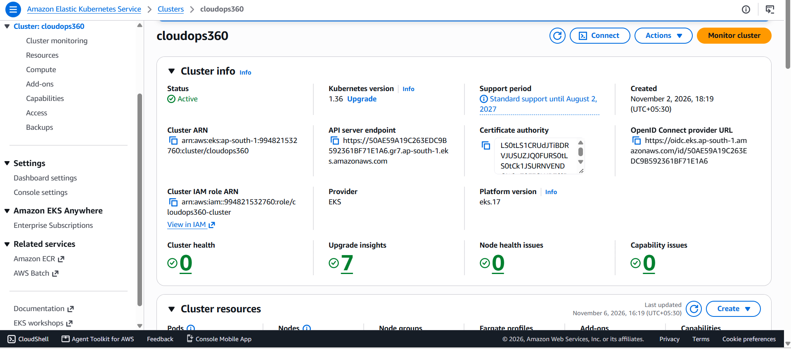

**EKS Node Group**

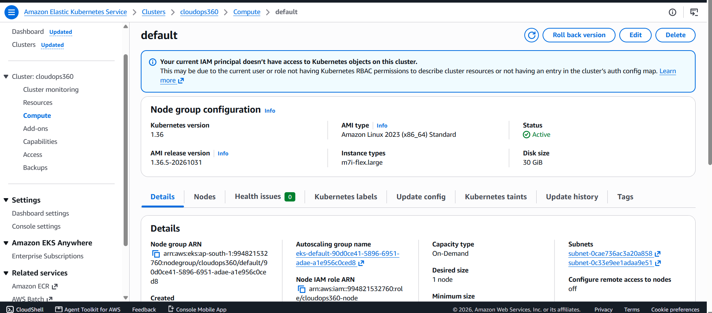

**EC2 Worker**

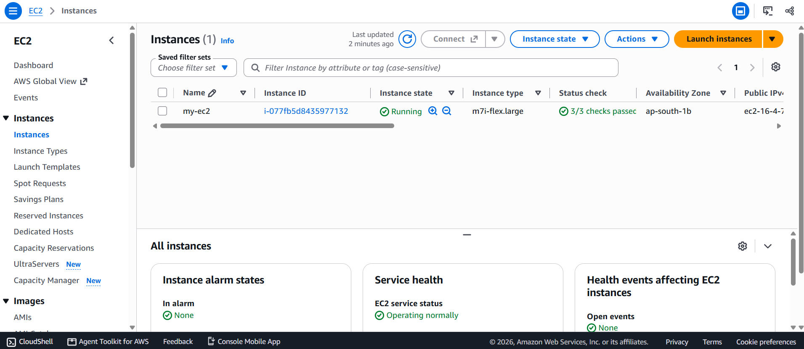

**VPC Networking**


**Amazon ECR Repositories**


**Terraform State Bucket**


## 🛠️ Installation and Setup

The project uses a Windows-based local development workflow with PowerShell, Docker Desktop and supporting DevOps tools.

### Prerequisites

Install the tools required by the parts of the project you intend to run.

| Tool | Purpose |
|---|---|
| Git | Clone and manage the repository |
| Docker Desktop | Build and run containers |
| WSL2 | Linux environment for Docker Desktop |
| Python | Backend and Inventory service |
| Node.js and npm | Frontend development |
| Java | Orders service |
| Maven | Java build and tests |
| kubectl | Kubernetes management |
| kind | Local Kubernetes cluster |
| Helm | Kubernetes deployment configuration |
| AWS CLI | Optional AWS operations |
| Terraform | Infrastructure configuration |
| Ansible | Configuration management |

### Step 1: Clone the Repository

```powershell
git clone -b upgrade/spring-boot-4.0.9 https://github.com/kantamnenimanusha/cloudops-360.git

cd cloudops-360
```

### Step 2: Check Prerequisites

The repository includes a PowerShell prerequisite-check script.

```powershell
.\scripts\windows\00-check-prereqs.ps1
```

Review the output and install any missing dependencies required for your workflow.

### Step 3: Review the Repository

```powershell
Get-ChildItem
```

Review the application directories, deployment configuration, infrastructure files and scripts before starting services.

### Step 4: Configure the Local Environment

The repository includes a local configuration script.

```powershell
.\scripts\windows\01-configure.ps1 -GitHubUser YOUR_GITHUB_USERNAME
```

Replace the placeholder with your GitHub username. Review the script and its parameters before execution.

Do not commit generated secrets or local environment files.

### Step 5: Run Application Tests

The repository includes a test script:

```powershell
.\scripts\windows\test-all.ps1
```

Review the output to identify which test suites ran and whether they completed successfully.

### Step 6: Create the Local Kubernetes Cluster

```powershell
.\scripts\windows\02-create-cluster.ps1
```

Review the script and prerequisites before running it.

### Step 7: Start Local CI Services

```powershell
.\scripts\windows\03-start-ci.ps1
```

This script supports the local CI environment. Review its configuration and required resources before execution.

### Step 8: Inspect the Environment

```powershell
docker ps

kubectl get nodes

kubectl get pods -A

kubectl get services -A
```

These commands help inspect Docker containers and Kubernetes resources in the active environment.

### Additional Scripts

The repository also includes scripts for Argo CD installation, image building and pushing, GitOps bootstrap, port forwarding, Jenkins Kubernetes configuration and cleanup.

Review each script before execution. Some operations require AWS credentials, Kubernetes access, configured Jenkins credentials or other environment-specific settings.

---

## 📁 Repository Structure

The main repository contains application code, CI/CD configuration, deployment configuration, infrastructure files, automation scripts and documentation.

```text
cloudops-360/
│
├── apps/
│   ├── backend/
│   │   ├── app/
│   │   └── tests/
│   │
│   ├── frontend/
│   │   └── src/
│   │
│   ├── inventory-service/
│   │   ├── app/
│   │   └── tests/
│   │
│   └── orders-service/
│       └── src/
│
├── ci/
│   └── jenkins/
│       ├── casc.yaml
│       ├── Dockerfile
│       ├── Jenkinsfile
│       └── plugins.txt
│
├── gitops/
│   ├── argocd/
│   ├── charts/
│   └── envs/
│       ├── aws/
│       └── local/
│
├── infra/
│   ├── ansible/
│   ├── kubernetes/
│   └── terraform/
│       ├── bootstrap/
│       ├── envs/
│       └── modules/
│
├── docs/
│   ├── architecture.md
│   ├── aws-deployment.md
│   ├── cost-management.md
│   ├── demo-guide.md
│   ├── interview-prep.md
│   ├── learning-guide.md
│   ├── troubleshooting.md
│   ├── VERSIONS.md
│   └── images/
│
├── scripts/
│   └── windows/
│
├── security/
│   └── .trivyignore
│
├── .gitignore
└── README.md
```

### Directory Responsibilities

| Directory | Responsibility |
|---|---|
| `apps/backend/` | FastAPI backend application |
| `apps/frontend/` | React frontend |
| `apps/inventory-service/` | Inventory service |
| `apps/orders-service/` | Spring Boot Orders service |
| `ci/jenkins/` | Jenkins pipeline and configuration |
| `gitops/` | Helm charts, environment manifests and Argo CD configuration |
| `infra/terraform/` | Terraform infrastructure configuration |
| `infra/ansible/` | Ansible playbooks and roles |
| `infra/kubernetes/` | Kubernetes-related configuration |
| `scripts/windows/` | PowerShell automation scripts |
| `security/` | Trivy ignore configuration |
| `docs/` | Project documentation and screenshots |

This is a high-level repository map rather than a complete listing of every file.

---

## 🔐 Security Considerations

CloudOps 360 includes security-related configuration and practices across application development, CI/CD and infrastructure.

Important precautions:

- Keep credentials out of source code.
- Do not commit `.env` files.
- Do not commit private keys, certificates or kubeconfig files.
- Keep Terraform state files and plan files out of Git.
- Review files before staging or committing.
- Use appropriate AWS IAM permissions.
- Store Jenkins credentials using Jenkins credential management.
- Avoid exposing local development services publicly.
- Review container and dependency scan results before publishing images.

The local Jenkins setup uses Docker socket access. Access to the Docker socket can provide extensive control over the Docker host, so this setup should be restricted to a trusted development environment.

Before committing changes, inspect the repository:

```powershell
git status
```

Review both staged and unstaged files carefully.

---

## ⚠️ Current Limitations

The following points describe the boundaries of the current implementation and verification.

- **GitOps:** Deployment configuration and Argo CD definitions are maintained in the repository, but active Argo CD reconciliation in EKS has not been verified.
- **AWS deployment:** Selected AWS infrastructure resources have been inspected, but the complete infrastructure provisioning and application deployment workflow has not been independently validated end to end.
- **Pipeline coverage:** The Jenkinsfile defines multiple stages, but the successful Orders pipeline build does not establish that every stage passes for all four applications.
- **Optional rollout verification:** Kubernetes rollout verification is controlled by a Jenkins parameter and requires Kubernetes configuration inside Jenkins.
- **Monitoring:** Prometheus targets and Grafana dashboards were inspected. A complete alert-delivery workflow has not been verified.
- **Logging and tracing:** Configuration files may exist for additional observability tools, but this README does not claim active centralised logging or distributed tracing.
- **Production readiness:** This is a learning and portfolio project. Additional security hardening, operational testing, access controls and production-level validation would be required before real production use.

---

## 🎓 Learning Outcomes

Working on CloudOps 360 provided practical exposure to multiple areas of application development and DevOps.

Key learning areas include:

- Developing a multi-service application using React, Python, FastAPI, Java and Spring Boot.
- Managing source code using Git and GitHub.
- Creating and troubleshooting Jenkins CI/CD pipelines.
- Reusing one pipeline across multiple application jobs.
- Integrating SonarQube into code-quality checks.
- Scanning dependencies and container images using Trivy.
- Building and managing Docker containers.
- Working with Kubernetes resources and deployments.
- Managing Kubernetes configuration using Helm.
- Understanding GitOps repository structures and deployment configuration.
- Exploring Infrastructure as Code using Terraform.
- Working with Ansible configuration files and playbooks.
- Exploring AWS services including EKS, EC2, VPC, ECR, S3 and IAM.
- Inspecting application and infrastructure metrics using Prometheus and Grafana.
- Troubleshooting issues across application, build, container and infrastructure layers.
- Understanding the importance of documentation, verification and secure configuration management.

---

## 📚 Additional Documentation

The repository includes separate documents for deeper explanations and practical guidance.

| Document | Description |
|---|---|
| [Architecture](docs/architecture.md) | Project architecture and component overview |
| [AWS Deployment](docs/aws-deployment.md) | AWS deployment information |
| [Cost Management](docs/cost-management.md) | Cloud resource and cost considerations |
| [Demo Guide](docs/demo-guide.md) | Project demonstration guidance |
| [Interview Preparation](docs/interview-prep.md) | Technical concepts and project discussion |
| [Learning Guide](docs/learning-guide.md) | Learning and implementation guidance |
| [Troubleshooting](docs/troubleshooting.md) | Common issues and troubleshooting |
| [Versions](docs/VERSIONS.md) | Tool and component version information |
| [Security](security/README.md) | Security-related project information |

---

## 👩‍💻 Author

**Manusha Kantamaneni**

Computer Science and Engineering  
DevOps and Cloud Technology Enthusiast

- GitHub: [kantamnenimanusha](https://github.com/kantamnenimanusha)
- LinkedIn: [Manusha Kantamaneni](https://www.linkedin.com/in/manusha-kantamneni-47634b375/)

---

## ⭐ Acknowledgement

CloudOps 360 is a hands-on learning project focused on multi-service application development, CI/CD automation, containerisation, Kubernetes, infrastructure as code, AWS and monitoring.

Thank you for visiting the repository!

If you find the project useful, feel free to explore the code and share feedback.

---

<p align="center">
  <b>CloudOps 360 — Connecting Application Development with DevOps and Cloud Infrastructure.</b>
</p>
