# ☁️ CloudOps 360

### An End-to-End Cloud-Native DevOps Platform

**Automating application delivery, container orchestration, infrastructure management, and observability through an integrated DevOps workflow.**

<p align="center">
  
  
  
  
  
  
</p>

<p align="center">
  <a href="#-project-overview">Overview</a> •
  <a href="#-architecture">Architecture</a> •
  <a href="#-technology-stack">Tech Stack</a> •
  <a href="#-end-to-end-workflow">Workflow</a> •
  <a href="#-screenshots-and-demonstration">Screenshots</a> •
  <a href="#-installation-and-setup">Setup</a>
</p>

---

## 📌 Table of Contents

1. [Project Overview](#-project-overview)
2. [Objectives](#-project-objectives)
3. [Architecture](#-architecture)
4. [Technology Stack](#-technology-stack)
5. [Application Architecture](#-application-architecture)
6. [End-to-End Workflow](#-end-to-end-workflow)
7. [CI/CD Pipeline](#-cicd-pipeline)
8. [Containerization and Kubernetes](#-containerization-and-kubernetes)
9. [GitOps](#-gitops)
10. [Infrastructure as Code](#-infrastructure-as-code)
11. [Monitoring and Observability](#-monitoring-and-observability)
12. [Logging Architecture](#-logging-architecture)
13. [Security](#-security)
14. [Screenshots and Demonstration](#-screenshots-and-demonstration)
15. [Installation and Setup](#-installation-and-setup)
16. [Testing and Verification](#-testing-and-verification)
17. [Troubleshooting](#-troubleshooting)
18. [Repository Structure](#-repository-structure)
19. [Limitations and Future Improvements](#-limitations-and-future-improvements)
20. [Learning Outcomes](#-learning-outcomes)
21. [Author](#-author)

---

## 🚀 Project Overview

CloudOps 360 is a cloud-native DevOps platform developed to bring together application development, continuous integration, containerization, deployment automation, infrastructure management, and observability in one integrated project.

In traditional application environments, development, testing, deployment, infrastructure management, and monitoring can operate as separate activities. This makes application delivery harder to manage and troubleshooting more time-consuming.

CloudOps 360 demonstrates how these activities can be organised into a connected DevOps workflow.

The platform combines a multi-service application with DevOps tools and cloud-native technologies to demonstrate how an application can move from source-code changes through CI/CD and container deployment, while providing monitoring and logging capabilities.

### What does CloudOps 360 do?

- Provides a web-based application built with React and backend services.
- Uses Jenkins to automate application build and CI/CD activities.
- Integrates SonarQube into the code-quality workflow.
- Uses Docker to package application services into containers.
- Uses Kubernetes and Helm for container orchestration and deployment configuration.
- Maintains infrastructure automation using Terraform and Ansible.
- Uses Prometheus and Grafana for monitoring and visualisation.
- Uses Alloy and Loki for log collection and exploration.
- Maintains GitOps deployment configuration as part of the planned single-repository structure.

The project is intended as a hands-on demonstration of how different DevOps practices and tools work together.

> **Project status:** This repository contains implemented application and DevOps components at different levels of verification. Please refer to the verification and limitations sections before assuming that every optional integration is currently active.

---

## 🎯 Project Objectives

The main objectives of CloudOps 360 are:

1. **Automate application delivery:** Understand how source-code changes move through a CI/CD pipeline.
2. **Improve code quality:** Integrate automated code analysis into the development workflow.
3. **Containerise services:** Package application components into Docker images.
4. **Orchestrate deployments:** Use Kubernetes to manage containerised workloads.
5. **Automate infrastructure:** Maintain reusable infrastructure configuration through Terraform.
6. **Automate configuration:** Use Ansible for server configuration tasks.
7. **Monitor applications:** Collect metrics and visualise system behaviour.
8. **Centralise logs:** Collect and query application and infrastructure logs.
9. **Understand GitOps:** Organise deployment configuration separately from application source code while keeping it in one repository.
10. **Improve troubleshooting:** Understand how build failures, deployment issues, metrics, and logs can be investigated.

---

## 🏗️ Architecture

CloudOps 360 brings together the application layer, CI/CD workflow, deployment environment, infrastructure automation, and observability components.

### High-Level System Architecture

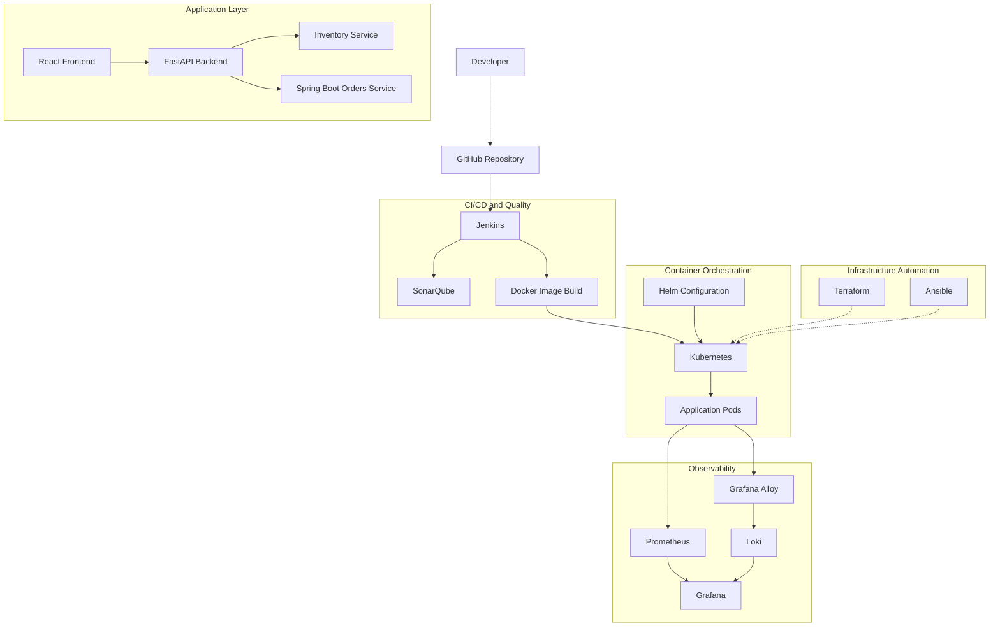

*The diagram represents the intended component relationships. The dotted infrastructure connections indicate automation/configuration responsibilities, not proof that every infrastructure operation has been deployed. Actual service communication and deployment paths should be checked against the manifests and code.*

### Architecture Layers

| Layer | Components | Responsibility |
|---|---|---|
| Source control | GitHub | Stores application source and configuration |
| Application | React, FastAPI, Spring Boot | Provides application functionality |
| CI/CD | Jenkins | Automates build and pipeline stages |
| Code quality | SonarQube | Analyses source code |
| Containerisation | Docker | Packages applications |
| Orchestration | Kubernetes | Manages container workloads |
| Deployment configuration | Helm | Packages Kubernetes resources |
| Infrastructure | Terraform | Defines infrastructure as code |
| Configuration management | Ansible | Automates server configuration |
| Monitoring | Prometheus | Collects metrics |
| Visualisation | Grafana | Displays metrics and logs |
| Logging | Alloy and Loki | Collects and stores/query logs |

---

## 🧰 Technology Stack

### Application Development

| Technology | Purpose |
|---|---|
| React | Builds the frontend user interface |
| JavaScript | Frontend application logic |
| FastAPI | Provides Python-based backend APIs |
| Python | Backend and service implementation |
| Spring Boot | Implements the Orders service |
| Java | Orders service programming language |
| Maven | Builds and tests the Java application |

### DevOps and Deployment

| Technology | Purpose |
|---|---|
| Git and GitHub | Version control and source-code management |
| Jenkins | Continuous integration and delivery automation |
| SonarQube | Static code analysis and quality checks |
| Docker | Application containerisation |
| Kubernetes | Container orchestration |
| Helm | Kubernetes package and deployment configuration |
| GitOps configuration | Maintains deployment-related configuration |

### Infrastructure and Configuration

| Technology | Purpose |
|---|---|
| Terraform | Infrastructure as Code |
| Ansible | Configuration management and automation |
| AWS | Optional cloud deployment target |
| PowerShell | Windows automation and project scripts |
| Linux | Server and automation environment |

### Monitoring and Logging

| Technology | Purpose |
|---|---|
| Prometheus | Metrics collection |
| Grafana | Monitoring dashboards and data visualisation |
| Grafana Alloy | Telemetry collection and forwarding |
| Loki | Log aggregation and querying |
| Alertmanager | Alert handling where configured |

---

## 🖥️ Application Architecture

CloudOps 360 contains a frontend and multiple backend services.

### 1. Frontend – React

The frontend provides the user-facing application interface.

Its responsibilities include:

- Rendering application pages and components.
- Communicating with backend APIs.
- Presenting application information.
- Providing a user interface for interacting with the platform.

### 2. Backend – FastAPI

The FastAPI backend acts as an API layer for the application.

Its responsibilities include:

- Exposing backend endpoints.
- Handling application requests.
- Managing application configuration.
- Integrating with supporting services and configured DevOps endpoints.
- Providing diagnostic information about configured integrations.

### 3. Inventory Service

The Inventory service is implemented using Python and FastAPI.

It represents a separate service responsible for inventory-related application functionality.

### 4. Orders Service

The Orders service is implemented using Java and Spring Boot.

It provides a separate service boundary for order-related functionality and is included in the Jenkins CI/CD workflow.

### Application Request Flow

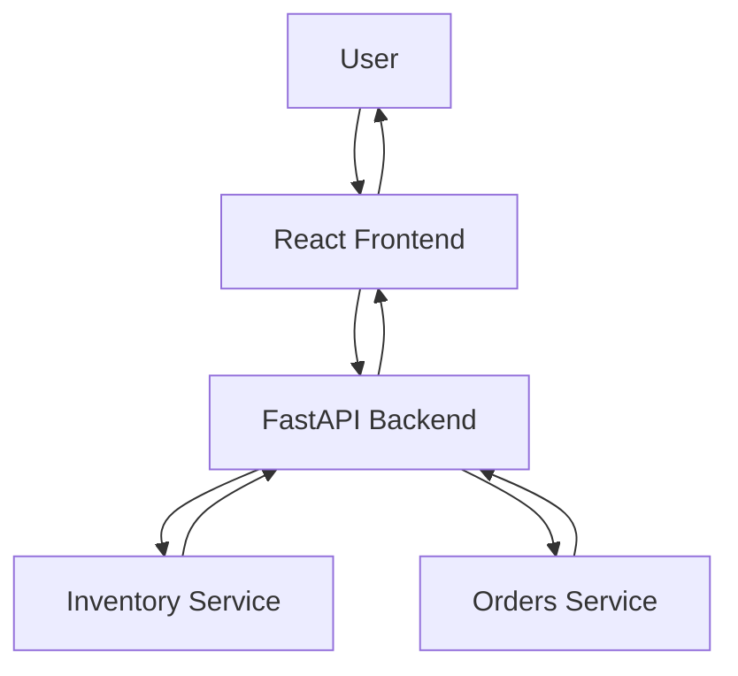

*This is a logical application interaction diagram. Verify individual API routes and communication methods from the source code before treating every arrow as a confirmed runtime call.*

---

## 🔄 End-to-End Workflow

The intended DevOps workflow follows this sequence:

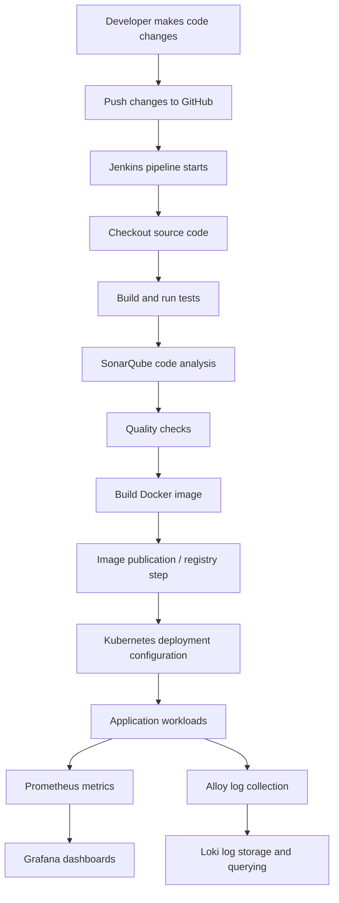

### Workflow Explanation

1. **Development:** A developer makes changes to the application or supporting configuration.
2. **Version control:** Changes are stored in GitHub.
3. **Continuous integration:** Jenkins checks out the relevant source code and runs configured pipeline stages.
4. **Testing:** Automated tests validate the application components.
5. **Code quality:** SonarQube analyses source code and provides quality information.
6. **Containerisation:** Docker packages application services into container images.
7. **Deployment:** Kubernetes deployment configuration defines how containerised workloads should run.
8. **Monitoring:** Prometheus collects available metrics and Grafana displays them.
9. **Logging:** Alloy collects configured logs and forwards them to Loki for querying and exploration.

The exact pipeline stages and deployment triggers depend on the Jenkinsfile and deployment configuration in the repository.

---

## ⚙️ CI/CD Pipeline

Jenkins is used as the CI/CD automation server in CloudOps 360.

The pipeline automates application delivery tasks and integrates code-quality checks.

### Jenkins Pipeline Responsibilities

- Source-code checkout.
- Application build.
- Automated test execution.
- SonarQube analysis.
- Quality-gate integration.
- Container image build and related delivery steps where configured.

### CI/CD Workflow

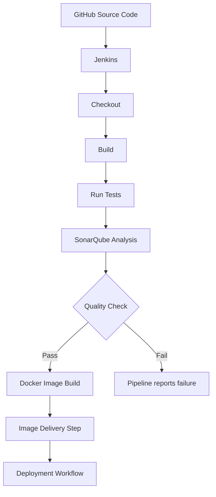

### Jenkins

Jenkins automates the pipeline so that repeatable build and verification activities can be executed consistently.

### SonarQube

SonarQube is integrated into the CI quality-check workflow.

It helps analyse source code and identify potential quality issues. The pipeline uses its quality-check integration to make code-quality feedback part of the build process.

**Verified project evidence:** The `orders-service` Jenkins pipeline completed successfully in build #16 after resolving a SonarQube credential issue.

*This does not mean that every possible pipeline stage or every service has been independently verified.*

---

## 🐳 Containerization and Kubernetes

### Docker

Docker is used to package application components into container images.

Containerisation provides:

- Consistent application packaging.
- Isolation between services.
- Repeatable execution environments.
- A standard image format for deployment.

Each service can be built and managed independently according to its Dockerfile and build configuration.

### Kubernetes

Kubernetes manages containerised workloads and provides orchestration capabilities.

The project includes Kubernetes deployment work and configuration for running application components.

Core Kubernetes concepts used in the project include:

| Kubernetes Resource | Purpose |
|---|---|
| Pod | Runs one or more containers |
| Deployment | Manages application pod replicas and updates |
| Service | Provides network access to selected pods |
| Namespace | Organises cluster resources |
| ConfigMap | Stores non-sensitive configuration |
| Secret | Stores sensitive configuration values |
| Helm | Packages and manages Kubernetes configuration |

Only resources present in the actual deployment manifests should be considered implemented.

### Deployment Flow

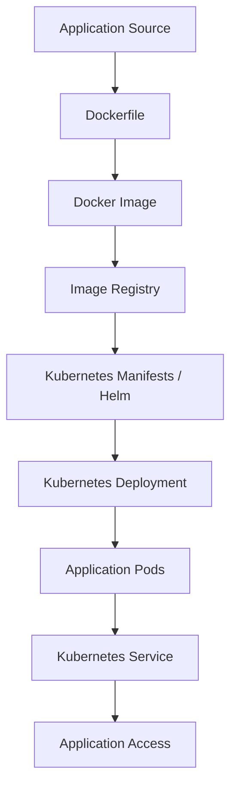

---

## 🔁 GitOps

GitOps is a deployment-management approach in which the desired application and infrastructure configuration is maintained in version control.

CloudOps 360 includes GitOps-related Kubernetes and Helm configuration in its companion repository, which is intended to be consolidated into the `gitops/` directory of this main repository.

### Intended GitOps Structure

```text
gitops/
├── applications/
├── charts/
├── environments/
└── README.md
```

*This is a proposed organisational structure. Retain the actual file and directory names from the existing GitOps repository during consolidation.*

### Important Status Note

GitOps configuration exists, but Argo CD is not installed in the EKS environment currently described for this project.

Therefore:

- GitOps configuration should not be confused with an active GitOps controller.
- Active Argo CD reconciliation is not claimed.
- Automatic deployment triggered by GitOps synchronisation is not claimed as verified.

---

## ☁️ Infrastructure as Code

Infrastructure as Code allows infrastructure configuration to be defined and maintained through version-controlled files.

### Terraform

Terraform is included for defining infrastructure resources.

Its purpose is to:

- Describe infrastructure declaratively.
- Maintain reusable configuration.
- Review planned changes before applying them.
- Support repeatable infrastructure provisioning.

Typical Terraform workflow:

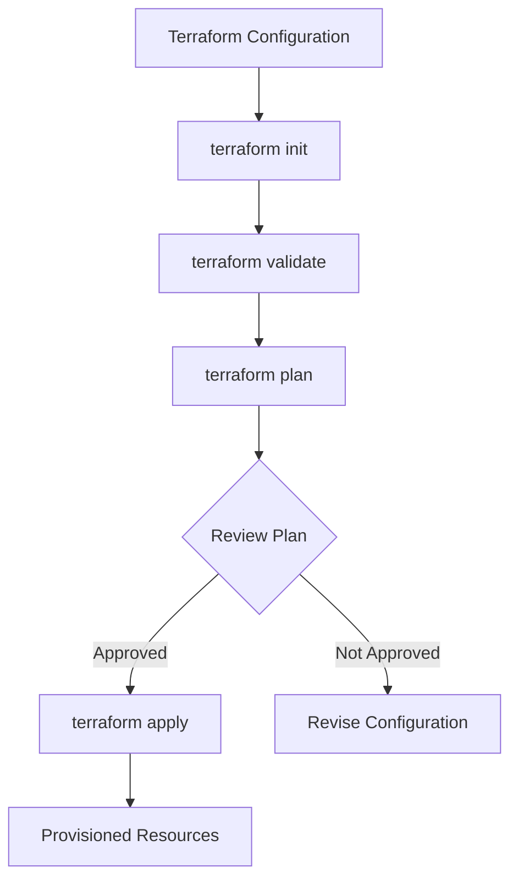

Example commands:

```powershell
terraform init
terraform validate
terraform plan
```

Do not run `terraform apply` against a real AWS account without reviewing the plan, permissions, budget, and resource impact.

### Ansible

Ansible is used for configuration-management automation.

It can automate tasks such as:

- Installing required packages.
- Configuring Linux servers.
- Managing services.
- Applying repeatable configuration through playbooks.

Example command pattern:

```bash
ansible-playbook -i inventory.ini playbook.yml
```

Use the actual inventory and playbook names present in the repository.

### AWS Deployment

AWS is an optional deployment target.

Terraform and Ansible configuration should not be treated as proof that all infrastructure has been provisioned successfully.

Refer to the infrastructure files and their verification status before attempting cloud deployment.

---

## 📊 Monitoring and Observability

Monitoring helps understand the health and performance of applications and infrastructure.

CloudOps 360 uses Prometheus and Grafana as its monitoring and visualisation components.

### Prometheus

Prometheus collects metrics from configured targets.

Metrics can help identify:

- Application availability.
- Service behaviour.
- Resource utilisation.
- Performance changes.
- Potential operational issues.

The actual metrics depend on the exporters and scrape targets configured in the project.

### Grafana

Grafana provides dashboards for visualising metrics.

It allows collected data to be presented through graphs, panels, and dashboards.

### Monitoring Flow

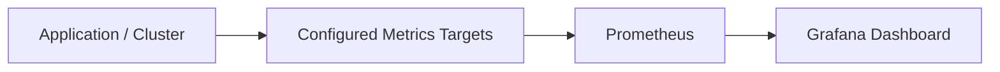

Prometheus and Grafana metrics and dashboards have been verified in the project environment.

---

## 📝 Logging Architecture

Logging provides information about application and system activity.

CloudOps 360 uses Grafana Alloy and Loki for its log-collection workflow.

### Grafana Alloy

Alloy is used as the telemetry collection and forwarding component.

It can discover and collect logs from configured sources and forward them to Loki.

### Loki

Loki is the log aggregation system.

It stores log data and makes it available for querying and exploration through Grafana.

### Logging Flow

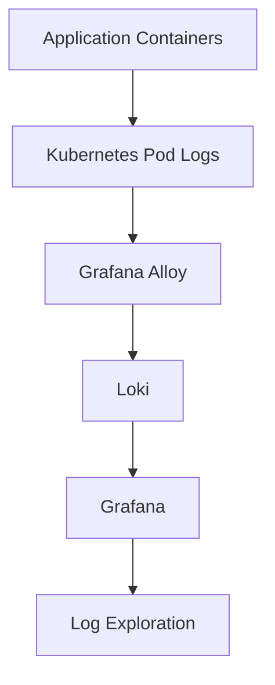

### Logging Status and Limitation

The Alloy and Loki log collection and viewing workflow has been verified.

The current configuration uses ephemeral storage for Loki, if retained in the deployment manifests. This means log data may not survive pod or cluster replacement.

The Alloy configuration also needs to be interpreted according to its actual discovery and relabelling rules; do not assume that collection is restricted exclusively to the `cloudops` namespace without verifying the active targets.

---

## 🔐 Security

Security is an important part of a DevOps workflow.

CloudOps 360 includes security-related configuration and practices such as:

- Keeping sensitive environment files out of version control.
- Using configuration files for environment-specific settings.
- Integrating code-quality checks into CI/CD.
- Maintaining secret-scanning configuration.
- Including container security scanning configuration where present.
- Avoiding the storage of credentials in source code.

### Important Security Consideration

The local Jenkins setup mounts the Docker socket. Access to the Docker socket can provide privileges equivalent to root access on the host.

This setup should therefore be used only in a trusted local development environment and not exposed as an unrestricted shared service.

Before publishing changes:

```powershell
git status
```

Review staged and unstaged files carefully and ensure that secrets, private keys, local environment files, and credentials are not committed.

---

## 📸 Screenshots and Demonstration

Screenshots provide visual evidence of the actual implementation.

The following section is intended to contain genuine screenshots captured from the CloudOps 360 environment.

Save the screenshots in:

```text
docs/images/
```

### 1. CloudOps 360 Application

Show the running frontend and its actual functionality.


### 2. Jenkins CI/CD Pipeline

Show the successful Jenkins pipeline and its actual stages.

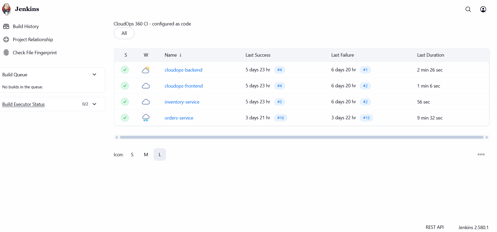

### 3. SonarQube Code Analysis

Show the project analysis and quality-gate result.

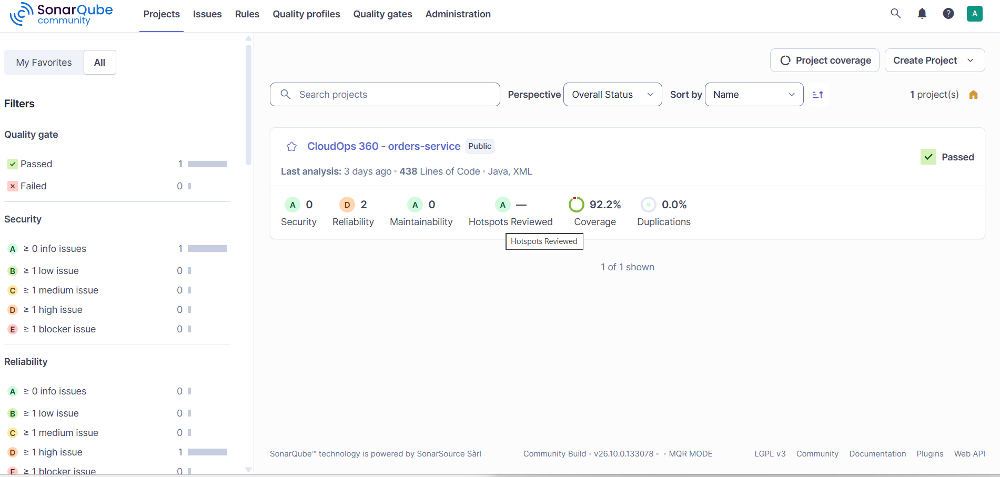

### 4. Kubernetes Workloads

Show actual pods, deployments, services, and namespaces.


### 5. Grafana Monitoring Dashboard

Show the verified monitoring dashboard.


### 6. Prometheus Metrics

Show the actual configured targets and metric collection status.

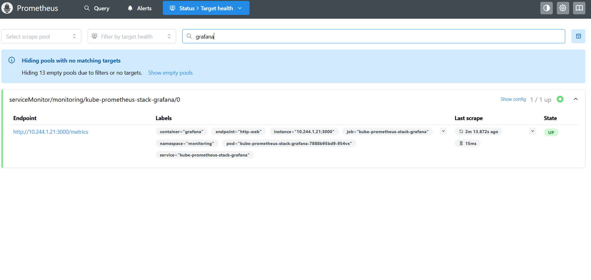

### 7. Loki Log Exploration

Show logs being queried and displayed in Grafana.


> **Screenshot note:** These are planned image paths. Add genuine screenshots from your own running project using the exact filenames above. Until those files exist, GitHub will display broken image placeholders. Do not substitute stock screenshots or fabricated output.

---

## 🛠️ Installation and Setup

The project has been developed with a Windows-based local workflow using PowerShell, Docker Desktop, and supporting DevOps tools.

### Prerequisites

Install the tools required by the parts of the project you intend to run.

| Tool | Purpose |
|---|---|
| Git | Clone and manage the repository |
| Docker Desktop | Build and run containers |
| WSL2 | Linux environment for Docker Desktop |
| kubectl | Interact with Kubernetes |
| kind | Local Kubernetes cluster, where used |
| Helm | Manage Kubernetes charts |
| Python | Run Python services and tests |
| Node.js and npm | Run the React frontend |
| Java | Build and run the Orders service |
| Maven | Java build and test automation |
| AWS CLI | Optional AWS operations |
| Terraform | Infrastructure as Code |
| Ansible | Configuration management |

The repository includes a prerequisite-check script:

```powershell
.\scripts\windows\00-check-prereqs.ps1
```

Review its output and install any missing dependencies.

### Step 1: Clone the Main Repository

```powershell
git clone -b upgrade/spring-boot-4.0.9 https://github.com/kantamnenimanusha/cloudops-360.git

cd cloudops-360
```

### Step 2: Review the Project Structure

```powershell
Get-ChildItem
```

Read the configuration and documentation before starting services.

### Step 3: Configure the Local Environment

The project contains a local configuration script:

```powershell
.\scripts\windows\01-configure.ps1 -GitHubUser <your-github-user>
```

Review the script before executing it. It may generate local configuration and secrets, so never commit the resulting sensitive files.

### Step 4: Run Tests

The repository provides a test script:

```powershell
.\scripts\windows\test-all.ps1
```

This is intended to run the configured test suites for the backend, inventory service, frontend, and Orders service.

Check the script output to confirm which test suites completed successfully.

### Step 5: Local Infrastructure and Deployment

The repository contains additional scripts for local cluster creation, CI services, image building, GitOps configuration, and port forwarding.

Review each script and its prerequisites before running it.

The intended script sequence is:

```powershell
.\scripts\windows\02-create-cluster.ps1
.\scripts\windows\03-start-ci.ps1
```

Other scripts for Argo CD installation, image building, GitOps bootstrapping, and port forwarding should only be run when their required components are intentionally being tested.

**Important:** Argo CD is not currently installed in the EKS environment described in the project verification notes. Do not interpret the presence of an installation script as proof of an active Argo CD deployment.

### Step 6: Verify the Environment

Use the appropriate commands for the components you have started.

```powershell
docker ps
kubectl get nodes
kubectl get pods -A
kubectl get services -A
```

For a local Kubernetes environment, these commands help verify cluster and workload status.

---

## 🧪 Testing and Verification

Testing is used to validate application functionality and reduce the risk of regressions.

### Test Technologies

| Component | Testing Tool |
|---|---|
| FastAPI backend | pytest |
| Inventory service | pytest |
| Frontend | Vitest |
| Orders service | Maven tests |

### Known Verification Evidence

| Component | Known result | Status |
|---|---|---|
| Backend API | Backend test suite executed successfully | Verified |
| Inventory service | 12 tests passed in a recorded run | Verified in that run |
| Orders service | 13 tests, 0 failures, 0 errors in a recorded run | Verified in that run |
| Jenkins Orders pipeline | Build #16 completed successfully after a SonarQube credential fix | Verified |
| SonarQube | Integrated into the CI quality-check workflow | Integration verified |
| Kubernetes | Cluster and application deployment work performed | Deployment work verified; current state may vary |
| Prometheus | Metrics and dashboards checked | Verified |
| Grafana | Monitoring dashboards checked | Verified |
| Alloy and Loki | Log collection and viewing checked | Verified |
| Argo CD | Not installed in the EKS environment described | Not active there |
| Jaeger | Not deployed in EKS; end-to-end tracing not verified | Not verified |
| Terraform and Ansible | Configuration files available | Not all infrastructure operations verified |
| AWS deployment | Optional configuration exists | Not claimed as fully deployed |

Test results are historical evidence from recorded runs. Re-run the tests in the current environment before using the results as a new release certification.

---

## 🧯 Troubleshooting

### Docker Desktop resource issues

If Docker containers fail to start or become unstable:

- Check Docker Desktop resource allocation.
- Check WSL2 memory settings.
- Close unnecessary containers and applications.
- Restart Docker Desktop after changing WSL configuration.

### Kubernetes pods not starting

Check pod status:

```powershell
kubectl get pods -A
```

Inspect a specific pod:

```powershell
kubectl describe pod <pod-name> -n <namespace>
```

Review logs:

```powershell
kubectl logs <pod-name> -n <namespace>
```

### Jenkins pipeline failure

Check:

- Jenkins console output.
- Source checkout configuration.
- Tool versions.
- Build and test output.
- SonarQube credentials and connectivity.
- Docker image build logs.

### Application connectivity issues

Check:

- Whether the required containers are running.
- Whether Kubernetes services exist.
- Whether the correct ports are exposed.
- Whether environment variables are configured.
- Whether the backend endpoints are reachable.

### Monitoring or logging issues

Check:

```powershell
kubectl get pods -A
kubectl get services -A
```

Also inspect the Prometheus targets, Alloy logs, Loki availability, and Grafana data-source configuration.

---

## 📂 Repository Structure

The final intended layout is a single repository containing the application, infrastructure, deployment configuration, and documentation.

```text
cloudops-360/
│
├── apps/
│   ├── backend/
│   ├── frontend/
│   ├── inventory-service/
│   └── orders-service/
│
├── ci/
│   └── jenkins/
│
├── gitops/
│   └── [consolidated GitOps configuration]
│
├── infra/
│   ├── terraform/
│   └── ansible/
│
├── local/
│
├── security/
│
├── scripts/
│   └── windows/
│
├── docs/
│   ├── architecture/
│   ├── images/
│   └── troubleshooting.md
│
├── .gitignore
├── .gitleaks.toml
├── CHECKLIST.md
└── README.md
```

*This is the target consolidated layout. The `gitops/` directory must be populated from the existing GitOps repository after reviewing and moving the relevant files. Retain any additional directories already present in the main repository.*

---

## ⚠️ Limitations and Future Improvements

CloudOps 360 is an evolving hands-on DevOps project. The following items represent limitations or potential improvements rather than completed functionality.

### Current Limitations

- Active Argo CD reconciliation is not available in the EKS environment described in the verification notes.
- End-to-end Jaeger tracing has not been verified.
- Loki currently uses ephemeral storage in the described configuration, if confirmed by the active manifests.
- Not every Terraform and Ansible operation has been independently verified against AWS.
- The status of local services and dashboards depends on whether the corresponding environment is running.
- The GitOps configuration still needs to be consolidated into the main repository.

### Future Improvements

- Complete and verify the single-repository GitOps structure.
- Deploy and validate an active GitOps controller.
- Configure persistent log storage.
- Implement and verify end-to-end distributed tracing.
- Expand automated test coverage.
- Improve deployment rollback and release strategies.
- Add more detailed dashboards and alerting rules.
- Strengthen security scanning and image-management practices.
- Validate the complete optional AWS deployment workflow with cost controls.

---

## 🎓 Learning Outcomes

Working on CloudOps 360 provides practical exposure to:

- Version control and collaborative development using Git and GitHub.
- CI/CD pipeline creation and troubleshooting with Jenkins.
- Code-quality integration using SonarQube.
- Containerisation using Docker.
- Kubernetes workloads and service management.
- Helm-based deployment configuration.
- Infrastructure as Code using Terraform.
- Configuration management using Ansible.
- Monitoring using Prometheus and Grafana.
- Log collection and analysis using Alloy and Loki.
- Understanding GitOps principles and deployment configuration.
- Debugging and troubleshooting across application and infrastructure layers.

The project brings these concepts together in one practical environment and helps demonstrate how DevOps tools support the application lifecycle.

---

## 👩‍💻 Author

**Manusha Kantamaneni**

Computer Science and Engineering | DevOps and Cloud Technology Enthusiast

- GitHub: [kantamnenimanusha](https://github.com/kantamnenimanusha)
- LinkedIn: [Manusha Kantamaneni](https://www.linkedin.com/in/manusha-kantamneni-47634b375/)

---

## ⭐ Acknowledgement

CloudOps 360 is a hands-on learning project focused on understanding and integrating DevOps, cloud-native technologies, automation, and observability practices.

Thank you for visiting the repository!

If you find the project useful, feel free to explore the code, review the documentation, and share feedback.

---

<p align="center">
  <b>CloudOps 360 — Bringing Development, Deployment, and Observability Together.</b>
</p>
