# ☁️ CloudOps 360

### An End-to-End Cloud-Native DevOps Platform

**Integrating application development, CI/CD automation, container orchestration, infrastructure management, and observability into a unified DevOps project.**

<p align="center">
  
  
  
  
  
  
</p>

<p align="center">
  <a href="#-project-overview">Overview</a> •
  <a href="#-architecture">Architecture</a> •
  <a href="#-technology-stack">Tech Stack</a> •
  <a href="#-end-to-end-workflow">Workflow</a> •
  <a href="#-screenshots-and-demonstration">Screenshots</a> •
  <a href="#-installation-and-setup">Setup</a>
</p>

---

## 📌 Table of Contents

1. [Project Overview](#-project-overview)
2. [Project Objectives](#-project-objectives)
3. [Architecture](#-architecture)
4. [Technology Stack](#-technology-stack)
5. [Application Architecture](#-application-architecture)
6. [End-to-End Workflow](#-end-to-end-workflow)
7. [CI/CD Pipeline](#-cicd-pipeline)
8. [Containerization and Kubernetes](#-containerization-and-kubernetes)
9. [GitOps](#-gitops)
10. [Infrastructure as Code](#-infrastructure-as-code)
11. [Monitoring and Observability](#-monitoring-and-observability)
12. [Logging Architecture](#-logging-architecture)
13. [Security](#-security)
14. [Screenshots and Demonstration](#-screenshots-and-demonstration)
15. [Installation and Setup](#-installation-and-setup)
16. [Testing and Verification](#-testing-and-verification)
17. [AWS Deployment and Infrastructure](#-aws-deployment-and-infrastructure)
18. [Troubleshooting](#-troubleshooting)
19. [Repository Structure](#-repository-structure)
20. [Limitations and Future Improvements](#-limitations-and-future-improvements)
21. [Learning Outcomes](#-learning-outcomes)
22. [Author](#-author)

---

## 🚀 Project Overview

CloudOps 360 is a cloud-native DevOps platform developed to bring together application development, continuous integration, containerization, deployment configuration, infrastructure automation, and observability.

In traditional application environments, development, testing, deployment, infrastructure management, and monitoring can operate as separate activities. CloudOps 360 demonstrates how these activities can be organised into a connected DevOps workflow.

The project combines a multi-service application with DevOps tools and cloud-native technologies to demonstrate how application components can be built, tested, containerised, deployed, and monitored.

### What does CloudOps 360 do?

- Provides a web-based application using React and backend services.
- Uses Jenkins to automate application build and CI/CD activities.
- Integrates SonarQube into the code-quality workflow.
- Uses Docker to package application services into container images.
- Uses Kubernetes and Helm for container orchestration and deployment configuration.
- Maintains infrastructure automation using Terraform and Ansible.
- Uses Prometheus and Grafana for monitoring and visualisation.
- Uses Grafana Alloy and Loki for log collection and exploration.
- Maintains Helm charts, Argo CD application definitions, and environment-specific configuration in the `gitops/` directory.
- Includes AWS infrastructure deployment resources and container image repositories.

> **Project status:** Application components, local DevOps workflows, and selected AWS infrastructure have been implemented and verified at different levels. Some optional integrations, including active Argo CD reconciliation and end-to-end tracing, remain unverified or inactive. Refer to the verification and limitations sections for details.

---

## 🎯 Project Objectives

The main objectives of CloudOps 360 are:

1. **Automate application delivery:** Understand how source-code changes move through a CI/CD pipeline.
2. **Improve code quality:** Integrate automated code analysis into the development workflow.
3. **Containerise services:** Package application components into Docker images.
4. **Orchestrate deployments:** Use Kubernetes to manage containerised workloads.
5. **Automate infrastructure:** Define infrastructure through reusable Terraform configuration.
6. **Automate configuration:** Use Ansible for server configuration tasks.
7. **Monitor applications:** Collect metrics and visualise system behaviour.
8. **Centralise logs:** Collect and query application and infrastructure logs.
9. **Understand GitOps:** Maintain deployment configuration in version control and understand declarative deployment practices.
10. **Explore cloud deployment:** Deploy and manage selected infrastructure components on AWS.
11. **Improve troubleshooting:** Investigate build failures, deployment issues, metrics, and logs.

---

## 🏗️ Architecture

CloudOps 360 brings together the application layer, CI/CD workflow, deployment environment, infrastructure automation, and observability components.

### High-Level System Architecture

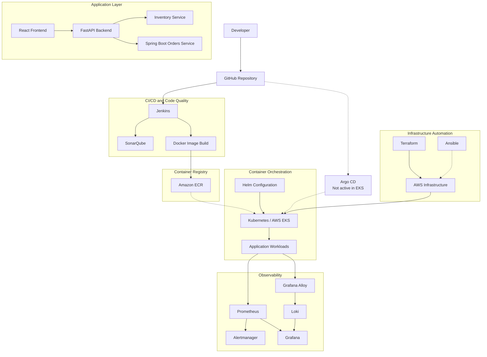

*The diagram combines the project's implemented components and intended integration paths. Dashed connections indicate configuration or intended workflows, not necessarily active automation. The actual execution path depends on the deployed environment and verified configuration.*

### Architecture Layers

| Layer | Components | Responsibility |
|---|---|---|
| Source control | GitHub | Source-code and configuration management |
| Application | React, FastAPI, Spring Boot | Application functionality |
| CI/CD | Jenkins | Build and pipeline automation |
| Code quality | SonarQube | Static code analysis |
| Containerisation | Docker | Application packaging |
| Container registry | Amazon ECR | Container image storage |
| Orchestration | Kubernetes, Amazon EKS | Container workload management |
| Deployment configuration | Helm, GitOps manifests | Kubernetes application configuration |
| Infrastructure | Terraform, AWS | Infrastructure provisioning and management |
| Configuration management | Ansible | Server configuration automation |
| Monitoring | Prometheus | Metrics collection |
| Alerting | Alertmanager | Alert handling where configured |
| Visualisation | Grafana | Metrics and log dashboards |
| Logging | Alloy and Loki | Log collection and querying |

---

## 🧰 Technology Stack

### Application Development

| Technology | Purpose |
|---|---|
| React | Frontend user interface |
| JavaScript | Frontend application logic |
| FastAPI | Python-based backend APIs |
| Python | Backend and service implementation |
| Spring Boot | Orders microservice |
| Java | Orders service programming language |
| Maven | Java build and test automation |

### DevOps and Deployment

| Technology | Purpose |
|---|---|
| Git and GitHub | Version control |
| Jenkins | Continuous integration and delivery automation |
| SonarQube | Static code analysis |
| Docker | Containerisation |
| Kubernetes | Container orchestration |
| Helm | Kubernetes package and deployment configuration |
| Argo CD | GitOps controller configuration; active EKS reconciliation not verified |

### Infrastructure and Cloud

| Technology | Purpose |
|---|---|
| Terraform | Infrastructure as Code |
| Ansible | Configuration management |
| AWS EKS | Managed Kubernetes control plane |
| Amazon EC2 | Kubernetes worker infrastructure |
| Amazon ECR | Container image repositories |
| Amazon VPC | Network isolation and connectivity |
| Amazon S3 | Terraform remote state storage |
| PowerShell | Windows automation |
| Linux | Server and automation environment |

### Monitoring and Logging

| Technology | Purpose |
|---|---|
| Prometheus | Metrics collection |
| Grafana | Dashboards and visualisation |
| Grafana Alloy | Telemetry collection and forwarding |
| Loki | Log aggregation and querying |
| Alertmanager | Alert handling where configured |

---

## 🖥️ Application Architecture

CloudOps 360 contains a frontend and multiple backend services.

### 1. Frontend – React

The frontend provides the user-facing application interface.

Responsibilities include:

- Rendering application pages and components.
- Communicating with backend APIs.
- Presenting application information.
- Providing a user interface for interacting with the platform.

### 2. Backend – FastAPI

The FastAPI backend acts as an API layer for the application.

Responsibilities include:

- Exposing backend endpoints.
- Handling application requests.
- Managing application configuration.
- Integrating with supporting services and configured DevOps endpoints.
- Providing diagnostic information about configured integrations.

### 3. Inventory Service

The Inventory service is implemented using Python and FastAPI.

It represents a separate service responsible for inventory-related application functionality.

### 4. Orders Service

The Orders service is implemented using Java and Spring Boot.

It provides a separate service boundary for order-related functionality and is included in the Jenkins CI/CD workflow.

### Application Request Flow

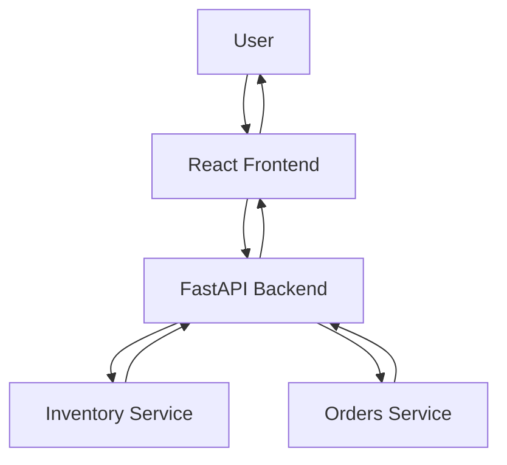

*This is a logical application interaction diagram. Individual API routes and communication methods depend on the actual application implementation.*

---

## 🔄 End-to-End Workflow

The intended DevOps workflow follows this sequence:

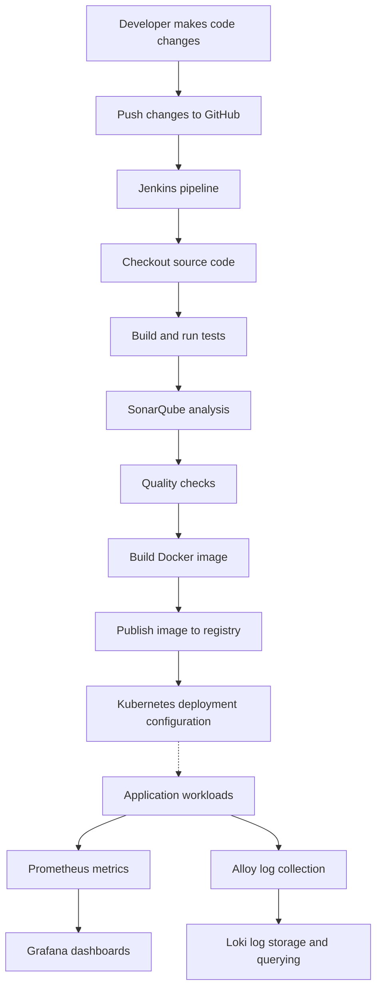

### Workflow Explanation

1. **Development:** A developer makes changes to the application or supporting configuration.
2. **Version control:** Changes are maintained in GitHub.
3. **Continuous integration:** Jenkins checks out the source code and executes configured pipeline stages.
4. **Testing:** Automated tests validate application components.
5. **Code quality:** SonarQube analyses source code and provides quality feedback.
6. **Containerisation:** Docker packages application services into container images.
7. **Image storage:** Amazon ECR provides repositories for application container images.
8. **Deployment configuration:** Kubernetes manifests and Helm charts define application deployment configuration.
9. **Monitoring:** Prometheus collects metrics and Grafana displays them.
10. **Logging:** Alloy collects configured logs and forwards them to Loki.

The exact pipeline stages, image publication process, and deployment triggers depend on the Jenkinsfile and deployment configuration. The diagram does not imply that every build automatically triggers a Kubernetes deployment.

---

## ⚙️ CI/CD Pipeline

Jenkins is used as the CI/CD automation server in CloudOps 360.

The pipeline automates application delivery tasks and integrates code-quality checks.

### Jenkins Pipeline Responsibilities

- Source-code checkout.
- Application build.
- Automated test execution.
- SonarQube analysis.
- Quality-gate integration.
- Container image build and related delivery steps where configured.

### CI/CD Workflow

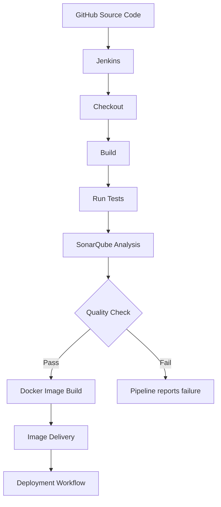

### Jenkins

Jenkins automates repeatable build and verification activities.

### SonarQube

SonarQube is integrated into the CI quality-check workflow. It analyses source code and provides feedback about potential quality issues.

**Verification evidence:** The Orders service Jenkins pipeline completed successfully in build **#16** after resolving a SonarQube credential issue.

This confirms that the recorded Orders pipeline run succeeded. It does not mean that every pipeline stage or every service has been independently verified.

---

## 🐳 Containerization and Kubernetes

### Docker

Docker packages application components into container images.

Containerisation provides:

- Consistent application packaging.
- Isolation between services.
- Repeatable execution environments.
- A standard image format for deployment.

Each service can be built and managed independently according to its Dockerfile and build configuration.

### Kubernetes

Kubernetes manages containerised workloads and provides orchestration capabilities.

The project includes Kubernetes deployment work and configuration for running application components.

| Kubernetes Resource | Purpose |
|---|---|
| Pod | Runs one or more containers |
| Deployment | Manages application pod replicas and updates |
| Service | Provides network access to selected pods |
| Namespace | Organises cluster resources |
| ConfigMap | Stores non-sensitive configuration |
| Secret | Stores sensitive configuration values |
| Helm | Packages and manages Kubernetes configuration |

Only resources present in the actual deployment manifests should be considered implemented.

### Deployment Flow

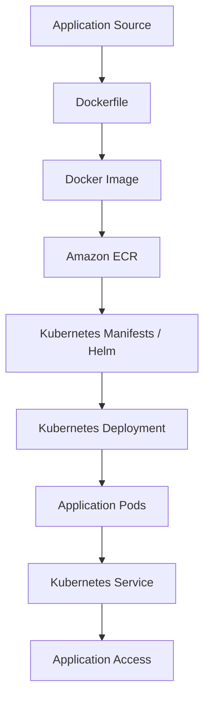

*This represents the standard deployment flow. The actual image-publishing process and deployment trigger depend on the configured environment.*

---

## 🔁 GitOps

GitOps is a deployment-management approach in which desired application and infrastructure configuration is maintained in version control.

CloudOps 360 maintains GitOps configuration inside the `gitops/` directory of the main repository.

### GitOps Directory Structure

```text
gitops/
├── argocd/
├── charts/
└── envs/
```

The directory includes Helm charts, Argo CD application definitions, and environment-specific Kubernetes configuration.

### Intended GitOps Workflow

1. Application and deployment configuration are maintained in GitHub.
2. Helm charts define Kubernetes application resources.
3. Environment-specific values customise deployments.
4. Argo CD can monitor the Git repository and reconcile the desired cluster state when installed and configured.

### Current GitOps Status

- GitOps manifests and Helm charts are maintained in the repository.
- Active Argo CD reconciliation is not currently verified in the EKS cluster.
- Automatic deployment triggered by GitOps synchronisation has not been verified.
- The presence of GitOps configuration should not be confused with an active GitOps controller.

---

## ☁️ Infrastructure as Code

Infrastructure as Code allows infrastructure configuration to be defined and maintained through version-controlled files.

### Terraform

Terraform is included for defining and managing infrastructure resources.

Its responsibilities include:

- Describing infrastructure declaratively.
- Maintaining reusable configuration.
- Reviewing planned changes before applying them.
- Supporting repeatable infrastructure provisioning.
- Maintaining remote state for infrastructure management.

Typical Terraform workflow:

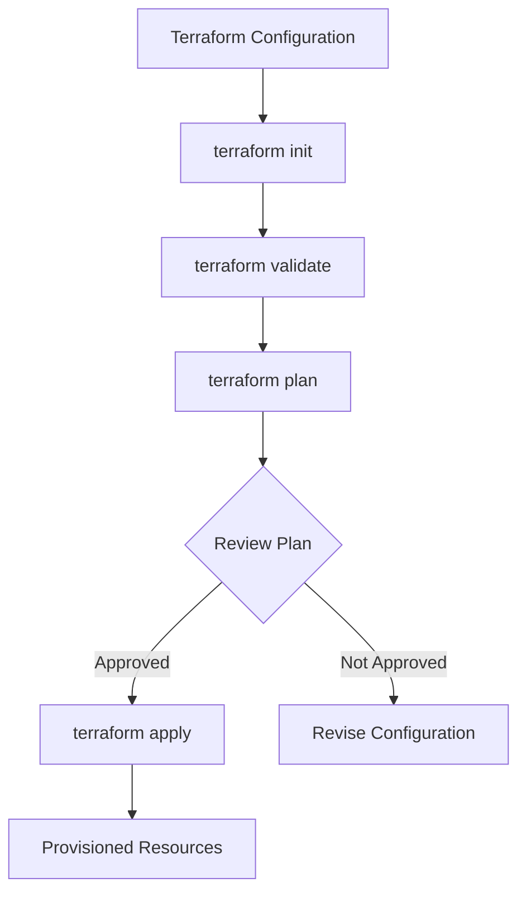

Example commands:

```powershell
terraform init
terraform validate
terraform plan
```

Do not run `terraform apply` against a real AWS account without reviewing the plan, permissions, budget, and resource impact.

### Ansible

Ansible is included for configuration-management automation.

It can automate tasks such as:

- Installing required packages.
- Configuring Linux servers.
- Managing services.
- Applying repeatable configuration through playbooks.

Example command pattern:

```bash
ansible-playbook -i inventory.ini playbook.yml
```

Use the actual inventory and playbook names present in the repository.

---

## 📊 Monitoring and Observability

Monitoring helps understand the health and performance of applications and infrastructure.

CloudOps 360 uses Prometheus and Grafana as its primary monitoring and visualisation components.

### Prometheus

Prometheus collects metrics from configured targets.

Metrics can help identify:

- Application availability.
- Service behaviour.
- Resource utilisation.
- Performance changes.
- Potential operational issues.

The actual metrics depend on the exporters and scrape targets configured in the project.

### Grafana

Grafana provides dashboards for visualising metrics.

It allows collected data to be presented through graphs, panels, and dashboards.

### Monitoring Flow

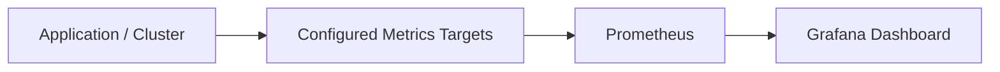

Prometheus targets and Grafana dashboards have been checked in the project environment.

### Alerting

Alertmanager is included in the project's monitoring configuration where configured.

It is intended to receive and manage alerts generated by Prometheus alert rules. End-to-end alert delivery should be verified against active rules, routes, receivers, and webhook configuration before claiming complete alerting functionality.

---

## 📝 Logging Architecture

Logging provides information about application and system activity.

CloudOps 360 uses Grafana Alloy and Loki for its log-collection workflow.

### Grafana Alloy

Alloy is used as the telemetry collection and forwarding component.

It can discover and collect logs from configured sources and forward them to Loki.

### Loki

Loki is the log aggregation system.

It stores log data and makes it available for querying and exploration through Grafana.

### Logging Flow

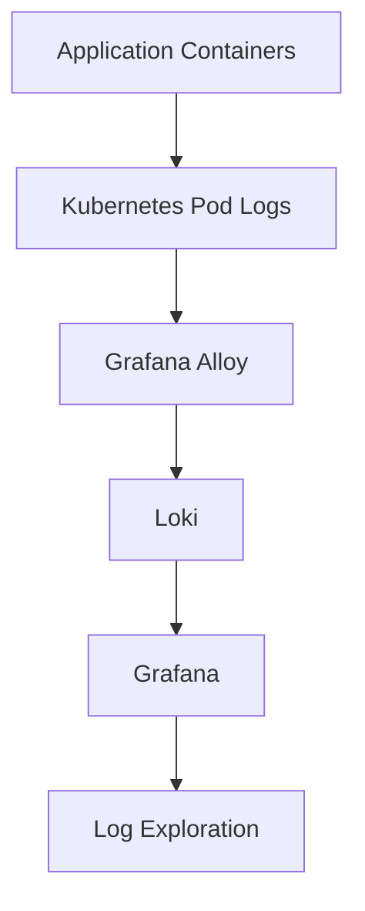

### Logging Status and Limitation

The Alloy and Loki log collection and viewing workflow has been verified in the development environment.

The current Loki configuration uses ephemeral storage. This means log data may not survive pod or cluster replacement.

The Alloy configuration should also be interpreted according to its actual discovery and relabelling rules. Do not assume that collection is restricted exclusively to the `cloudops` namespace without verifying the active targets.

---

## 🔐 Security

Security is an important part of a DevOps workflow.

CloudOps 360 includes security-related configuration and practices such as:

- Keeping sensitive environment files out of version control.
- Using configuration files for environment-specific settings.
- Integrating code-quality checks into CI/CD.
- Maintaining secret-scanning configuration.
- Including container security scanning configuration where present.
- Avoiding the storage of credentials in source code.
- Using IAM roles for AWS workloads where appropriate.

### Important Security Considerations

The local Jenkins setup mounts the Docker socket. Access to the Docker socket can provide privileges equivalent to root access on the host.

This setup should therefore be used only in a trusted local development environment and should not be exposed as an unrestricted shared service.

Before publishing changes:

```powershell
git status
```

Review staged and unstaged files carefully. Ensure that secrets, private keys, local environment files, Terraform state files, and credentials are not committed.

---

## 📸 Screenshots and Demonstration

The following screenshots provide visual evidence of the local application, DevOps workflows, monitoring environment, and AWS infrastructure.

### Local Application and DevOps Environment

#### 1. CloudOps Dashboard

Shows the application dashboard and service overview.


#### 2. Jenkins CI/CD Pipeline

Shows the Jenkins pipeline execution and build stages.


#### 3. SonarQube Code Analysis

Shows the code-quality analysis interface.


#### 4. Kubernetes Workloads

Shows Kubernetes deployments, pods, and services.


#### 5. Grafana Monitoring Dashboard

Shows application and infrastructure monitoring metrics.


#### 6. Prometheus Targets

Shows the monitoring targets and their scrape status.


#### 7. Loki Log Monitoring

Screenshot to be added after capturing and verifying the Loki log interface.

<!-- Add docs/images/loki-logs.png when available -->

### AWS Infrastructure Screenshots

The following screenshots document the AWS resources verified in the Mumbai region (`ap-south-1`).

#### 8. Amazon EKS Cluster

Shows the `cloudops360` EKS cluster, its active status, and Kubernetes version.


#### 9. EKS Managed Node Group

Shows the `default` managed node group and its worker configuration.


#### 10. Amazon EC2 Worker Instance

Shows the EC2 instance associated with the EKS worker node group.


#### 11. Amazon VPC Networking

Shows the project VPC, subnets, internet gateway, and network resource relationships.

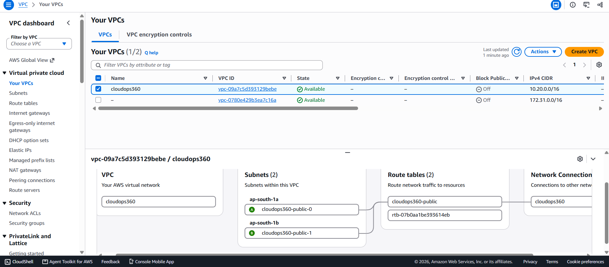

#### 12. Amazon ECR Repositories

Shows the four application container image repositories.

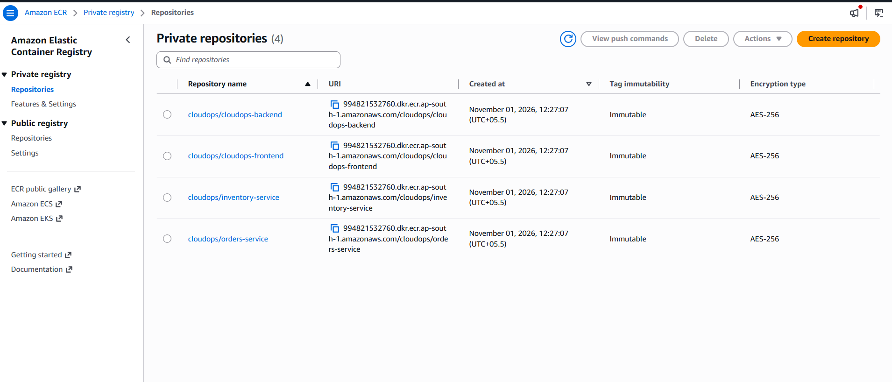

#### 13. Amazon S3 Terraform State Bucket

Shows the S3 bucket configuration used for Terraform remote state storage.

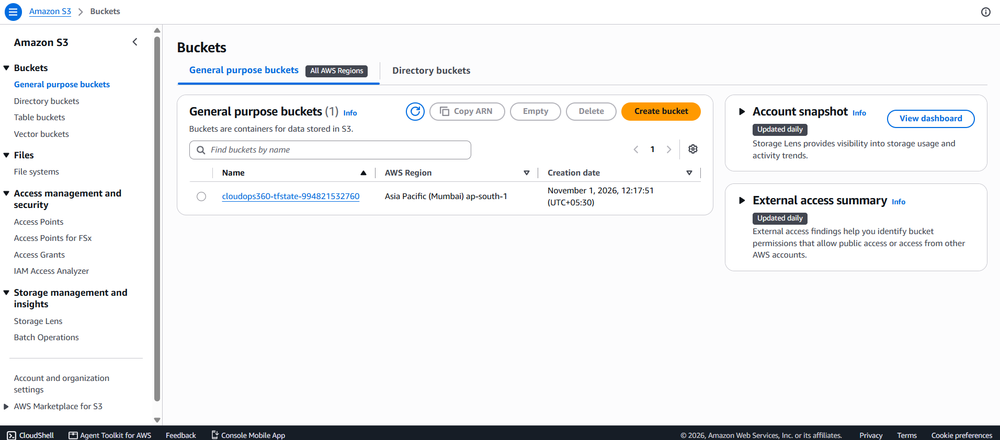

*Screenshots represent the resources and interfaces observed during project verification. They do not imply that all resources remain active indefinitely or that every optional integration is enabled.*

---

## 🛠️ Installation and Setup

The project has been developed with a Windows-based local workflow using PowerShell, Docker Desktop, and supporting DevOps tools.

### Prerequisites

Install the tools required by the parts of the project you intend to run.

| Tool | Purpose |
|---|---|
| Git | Clone and manage the repository |
| Docker Desktop | Build and run containers |
| WSL2 | Linux environment for Docker Desktop |
| kubectl | Interact with Kubernetes |
| kind | Local Kubernetes cluster, where used |
| Helm | Manage Kubernetes charts |
| Python | Run Python services and tests |
| Node.js and npm | Run the React frontend |
| Java | Build and run the Orders service |
| Maven | Java build and test automation |
| AWS CLI v2 | Optional AWS operations |
| Terraform | Infrastructure as Code |
| Ansible | Configuration management |

The repository includes a prerequisite-check script:

```powershell
.\scripts\windows\00-check-prereqs.ps1
```

Review its output and install any missing dependencies required for your chosen workflow.

### Step 1: Clone the Main Repository

```powershell
git clone -b upgrade/spring-boot-4.0.9 https://github.com/kantamnenimanusha/cloudops-360.git

cd cloudops-360
```

### Step 2: Review the Project Structure

```powershell
Get-ChildItem
```

Read the project documentation and configuration before starting services.

### Step 3: Configure the Local Environment

The project contains a local configuration script:

```powershell
.\scripts\windows\01-configure.ps1 -GitHubUser YOUR_GITHUB_USERNAME
```

Replace `YOUR_GITHUB_USERNAME` with your GitHub username.

Review the script before executing it. It may generate local configuration and secrets. Never commit the resulting sensitive files.

### Step 4: Run Tests

The repository provides a test script:

```powershell
.\scripts\windows\test-all.ps1
```

This is intended to run the configured test suites for the backend, inventory service, frontend, and Orders service.

Check the script output to confirm which test suites completed successfully.

### Step 5: Start the Local Environment

The repository contains scripts for local cluster creation and CI services.

```powershell
.\scripts\windows\02-create-cluster.ps1
.\scripts\windows\03-start-ci.ps1
```

Review each script and its prerequisites before running it. These scripts represent optional local workflows and should be executed only when their associated components are required.

The GitOps configuration is maintained under the `gitops/` directory in this repository. There is no need to clone or manually copy a separate GitOps repository.

### Step 6: Verify the Environment

Use the appropriate commands for the components you have started.

```powershell
docker ps
kubectl get nodes
kubectl get pods -A
kubectl get services -A
```

For a local Kubernetes environment, these commands help verify cluster and workload status.

---

## 🧪 Testing and Verification

Testing validates application functionality and reduces the risk of regressions.

### Test Technologies

| Component | Testing Tool |
|---|---|
| FastAPI backend | pytest |
| Inventory service | pytest |
| Frontend | Vitest |
| Orders service | Maven tests |

### Recorded Verification Evidence

| Component | Recorded result | Status |
|---|---|---|
| Backend API | Backend test suite executed successfully in recorded runs | Verified in recorded runs |
| Inventory service | 12 tests passed in a recorded run | Verified in that run |
| Orders service | 13 tests, 0 failures, 0 errors in a recorded run | Verified in that run |
| Jenkins Orders pipeline | Build #16 completed successfully after a SonarQube credential fix | Verified |
| SonarQube | Integrated into the CI quality-check workflow | Integration verified |
| Kubernetes | Cluster and application deployment work performed | Deployment work verified; current state may vary |
| Prometheus | Metrics targets checked | Verified |
| Grafana | Monitoring dashboards checked | Verified |
| Alloy and Loki | Log collection and viewing checked | Verified |
| Amazon EKS | `cloudops360` cluster observed in Active state, Kubernetes 1.36 | AWS resource verified |
| EKS node group | `default` node group observed in Active state | AWS resource verified |
| EC2 | EKS worker instance observed in Running state | AWS resource verified |
| Amazon VPC | Project VPC and networking resources identified | AWS resources verified |
| Amazon ECR | Four application repositories identified | AWS resources verified |
| Amazon S3 | Terraform state bucket, versioning, and encryption identified | AWS resource verified |
| Argo CD | Not installed in the EKS environment described | Not active there |
| Jaeger | Not deployed in EKS; end-to-end tracing not verified | Not verified |
| Terraform and Ansible | Configuration available; not every operation independently tested | Partially verified |

Test results are historical evidence from recorded runs. Re-run the tests in the current environment before using the results as new release certification.

AWS resource verification confirms that the listed resources were present when inspected. It does not establish that every infrastructure resource was provisioned exclusively through the repository's current Terraform configuration.

---

## ☁️ AWS Deployment and Infrastructure

AWS was used as a cloud deployment environment for selected CloudOps 360 infrastructure components.

The verified AWS deployment is located in the **Asia Pacific (Mumbai) region (`ap-south-1`)**.

### AWS Services Used

| AWS Service | Purpose | Verified resource or configuration |
|---|---|---|
| Amazon EKS | Managed Kubernetes control plane | `cloudops360` cluster |
| Amazon EC2 | Kubernetes worker compute | `m7i-flex.large` worker instance |
| Amazon VPC | Network isolation | Project VPC with `10.20.0.0/16` CIDR |
| Amazon ECR | Container image storage | Four application repositories |
| Amazon S3 | Terraform remote state storage | Project state bucket |
| AWS IAM | Access control and service permissions | Cluster, node, and supporting project roles |
| Internet Gateway | Internet connectivity for the project VPC | Attached to project VPC |

### 1. Amazon EKS

An Amazon EKS cluster named `cloudops360` was verified in the Mumbai region.

| Property | Verified value |
|---|---|
| Cluster | `cloudops360` |
| Status | Active at time of inspection |
| Kubernetes version | `1.36` |
| Region | `ap-south-1` |
| VPC | Project VPC |
| Node groups | 1 |

### 2. Amazon EC2 and EKS Worker Node

The EKS managed node group uses an EC2 worker instance.

| Property | Verified value |
|---|---|
| Node group | `default` |
| Instance type | `m7i-flex.large` |
| Desired capacity | 1 |
| Minimum capacity | 1 |
| Maximum capacity | 1 |
| Instance state | Running at time of inspection |

The worker instance was identified through its EKS cluster and node-group tags.

### 3. Amazon VPC Networking

The project uses a dedicated VPC.

| Property | Verified value |
|---|---|
| VPC name | `cloudops360` |
| CIDR block | `10.20.0.0/16` |
| Subnets | 2 |
| Internet Gateway | Attached |
| Network region | `ap-south-1` |

The VPC provides the networking environment for the EKS cluster and its worker infrastructure.

### 4. Amazon ECR

Four private ECR repositories were identified for application container images:

- `cloudops/cloudops-backend`
- `cloudops/cloudops-frontend`
- `cloudops/inventory-service`
- `cloudops/orders-service`

These repositories provide storage for the project's container images.

### 5. Amazon S3 – Terraform Remote State

An S3 bucket is used for Terraform remote state storage.

Verified configuration includes:

- Bucket versioning enabled.
- Server-side encryption using SSE-S3.
- Terraform state objects stored under the project state prefix.

Terraform state files can contain sensitive infrastructure information. They must not be committed to GitHub or exposed publicly.

### 6. AWS IAM

IAM roles identified for the project include:

- `cloudops360-cluster`
- `cloudops360-node`
- `cloudops360-backend-readonly`

These roles provide identity and permissions for relevant AWS infrastructure and application operations.

### AWS Deployment Limitations

The following distinctions are important:

- The EKS cluster and its worker infrastructure were verified through AWS.
- ECR repositories and container image records were identified.
- The Terraform state bucket and its security settings were verified.
- Active Argo CD reconciliation was not verified.
- EKS control-plane logging was disabled during inspection.
- The existence of an AWS resource does not prove that every deployment or automation stage is fully operational.

### AWS Cost and Cleanup Considerations

AWS resources such as EKS clusters, EC2 instances, storage, networking components, and related services can incur charges.

The actual cost depends on the resource configuration, region, usage, and time resources remain active.

Before provisioning or modifying AWS infrastructure:

1. Review available credits and expiry.
2. Check the cost implications of each resource.
3. Verify AWS authentication and region.
4. Review Terraform configuration and remote state.
5. Run `terraform plan` before applying changes.
6. Monitor active resources and usage.

**Important:** The verified EKS cluster and running EC2 worker are billable resources. A future cleanup should inventory project-owned resources, distinguish them from unrelated account resources, and remove only resources confirmed to belong to CloudOps 360.

The repository includes a read-only AWS cleanup check:

```powershell
.\scripts\windows\aws-cleanup-check.ps1 -Region ap-south-1
```

A cleanup check is not the same as resource deletion. Review the resource inventory and dependencies before performing any destructive operation.

---

## 🧯 Troubleshooting

### Docker Desktop Resource Issues

If Docker containers fail to start or become unstable:

- Check Docker Desktop resource allocation.
- Check WSL2 memory settings.
- Close unnecessary containers and applications.
- Restart Docker Desktop after changing WSL configuration.

### Kubernetes Pods Not Starting

Check pod status:

```powershell
kubectl get pods -A
```

Inspect a specific pod:

```powershell
kubectl describe pod <pod-name> -n <namespace>
```

Review logs:

```powershell
kubectl logs <pod-name> -n <namespace>
```

### Jenkins Pipeline Failure

Check:

- Jenkins console output.
- Source checkout configuration.
- Tool versions.
- Build and test output.
- SonarQube credentials and connectivity.
- Docker image build logs.

### Application Connectivity Issues

Check:

- Whether the required containers are running.
- Whether Kubernetes services exist.
- Whether the correct ports are exposed.
- Whether environment variables are configured.
- Whether backend endpoints are reachable.

### Monitoring or Logging Issues

Check:

```powershell
kubectl get pods -A
kubectl get services -A
```

Also inspect Prometheus targets, Alloy logs, Loki availability, and Grafana data-source configuration.

---

## 📁 Repository Structure

CloudOps 360 follows a single-repository structure that keeps application source code, deployment configuration, infrastructure automation, and documentation together.

```text
cloudops-360/
│
├── apps/
│   ├── backend/             # FastAPI backend
│   ├── frontend/            # React frontend
│   ├── inventory-service/   # Inventory microservice
│   └── orders-service/      # Spring Boot microservice
│
├── gitops/
│   ├── argocd/              # Argo CD application definitions
│   ├── charts/              # Helm charts
│   ├── envs/                # Environment-specific configuration
│   └── README.md            # GitOps documentation
│
├── docs/
│   ├── architecture.md      # System architecture and workflows
│   └── images/              # Project screenshots
│
├── infra/
│   ├── terraform/           # Infrastructure as Code
│   └── ansible/             # Configuration management
│
├── scripts/                 # Setup, verification, and utility scripts
│
├── .gitignore
└── README.md
```

### Directory Responsibilities

| Directory | Purpose |
|---|---|
| `apps/` | Frontend, backend, and microservices |
| `gitops/` | Helm charts, Argo CD definitions, and environment configuration |
| `docs/` | Architecture documentation and screenshots |
| `infra/` | Infrastructure automation configuration |
| `scripts/` | Setup, verification, deployment, and utility scripts |

The directory tree is a high-level overview rather than an exhaustive listing of every project file.

The GitOps configuration is maintained inside the main repository. The presence of Argo CD manifests does not mean that an Argo CD controller is actively synchronising the cluster.

---

## ⚠️ Limitations and Future Improvements

CloudOps 360 demonstrates the integration of application development, CI/CD, containerisation, Kubernetes, infrastructure automation, and observability. Some components represent planned capabilities or configurations that have not yet been fully deployed or verified.

### Current Limitations

- **GitOps synchronization:** GitOps manifests and Helm charts are maintained in the `gitops/` directory. Argo CD is not currently installed in the EKS environment, so active reconciliation and automatic GitOps-based deployment have not been verified.
- **AWS deployment automation:** Selected AWS infrastructure resources have been verified. The complete AWS deployment workflow has not been independently validated end to end from a clean environment.
- **Control-plane logging:** EKS control-plane logging was disabled during the recorded AWS inspection.
- **Distributed tracing:** Jaeger is not currently deployed as an active tracing component. End-to-end distributed tracing has not been verified.
- **Log persistence:** Loki uses ephemeral storage, so collected logs may not survive pod replacement or restarts.
- **Jenkins security:** The local Jenkins setup uses Docker socket access. This grants Jenkins significant control over the Docker host.
- **Production readiness:** The project is a learning and portfolio implementation. Additional security hardening, persistent storage, access controls, and operational validation would be required before production use.

### Future Improvements

- Deploy and configure Argo CD to enable verified GitOps synchronisation.
- Complete and validate the AWS infrastructure deployment workflow.
- Introduce persistent storage for Loki.
- Deploy Jaeger and verify end-to-end distributed tracing.
- Strengthen Jenkins security and credential management.
- Add automated deployment and rollback verification.
- Improve monitoring, alerting, and operational documentation.
- Implement and verify a complete infrastructure cleanup workflow.

These improvements represent future work and should not be interpreted as already implemented functionality.

---

## 🎓 Learning Outcomes

Working on CloudOps 360 provides practical exposure to:

- Version control and collaborative development using Git and GitHub.
- CI/CD pipeline creation and troubleshooting with Jenkins.
- Code-quality integration using SonarQube.
- Containerisation using Docker.
- Kubernetes workloads and service management.
- Helm-based deployment configuration.
- Infrastructure as Code using Terraform.
- Configuration management using Ansible.
- AWS services including EKS, EC2, VPC, ECR, S3, and IAM.
- Monitoring using Prometheus and Grafana.
- Log collection and analysis using Alloy and Loki.
- GitOps principles and declarative deployment configuration.
- Debugging and troubleshooting across application and infrastructure layers.

The project brings these concepts together in a practical environment and demonstrates how DevOps tools support the application lifecycle.

---

## 👩‍💻 Author

**Manusha Kantamaneni**

Computer Science and Engineering | DevOps and Cloud Technology Enthusiast

- GitHub: [kantamnenimanusha](https://github.com/kantamnenimanusha)
- LinkedIn: [Manusha Kantamaneni](https://www.linkedin.com/in/manusha-kantamneni-47634b375/)

---

## ⭐ Acknowledgement

CloudOps 360 is a hands-on learning project focused on understanding and integrating DevOps, cloud-native technologies, automation, and observability practices.

Thank you for visiting the repository!

If you find the project useful, feel free to explore the code, review the documentation, and share feedback.

---

<p align="center">
  <b>CloudOps 360 — Bringing Development, Deployment, and Observability Together.</b>
</p>
