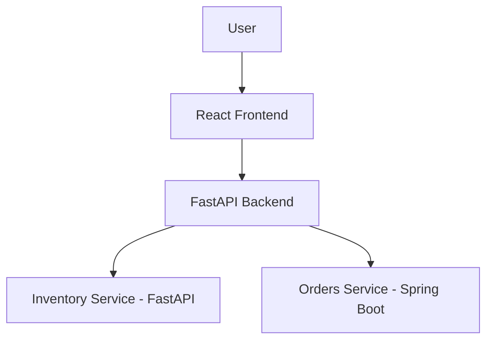
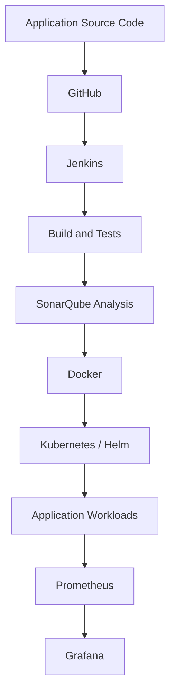
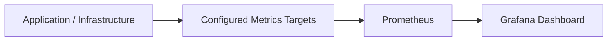

# ☁️ CloudOps 360

### A Multi-Service Application with DevOps and Cloud Infrastructure

CloudOps 360 is a hands-on DevOps project that brings together a multi-service application, CI/CD automation, containerisation, Kubernetes deployment, infrastructure configuration, and cloud infrastructure.

The project demonstrates practical use of DevOps tools across application development, build automation, container management, deployment, and monitoring.

<p align="center">
  
  
  
  
  
  
</p>

---

## 📌 Table of Contents

1. [Project Overview](#-project-overview)
2. [Project Objectives](#-project-objectives)
3. [Technology Stack](#-technology-stack)
4. [Application Architecture](#-application-architecture)
5. [Project Workflow](#-project-workflow)
6. [CI/CD Pipeline](#-cicd-pipeline)
7. [Docker and Kubernetes](#-docker-and-kubernetes)
8. [Deployment Configuration](#-deployment-configuration)
9. [Infrastructure and AWS](#-infrastructure-and-aws)
10. [Monitoring](#-monitoring)
11. [Testing and Verification](#-testing-and-verification)
12. [Screenshots](#-screenshots)
13. [Installation and Setup](#-installation-and-setup)
14. [Repository Structure](#-repository-structure)
15. [Security Considerations](#-security-considerations)
16. [Current Limitations](#-current-limitations)
17. [Learning Outcomes](#-learning-outcomes)
18. [Author](#-author)

---

## 🚀 Project Overview

CloudOps 360 is a multi-service application and DevOps implementation developed to understand how application development and deployment activities can be managed using commonly used DevOps tools.

The project contains a React frontend, a FastAPI backend, an Inventory service, and a Spring Boot Orders service.

Alongside application development, the project includes Jenkins-based CI/CD activities, SonarQube code analysis, Docker containerisation, Kubernetes deployment configuration, and monitoring using Prometheus and Grafana.

Selected cloud infrastructure components have also been provisioned or identified in AWS.

### What the project includes

- A React-based frontend.
- A FastAPI backend.
- A separate FastAPI Inventory service.
- A Spring Boot Orders service.
- Jenkins for CI/CD automation.
- SonarQube for code-quality analysis.
- Docker for containerisation.
- Kubernetes and Helm for container orchestration and deployment configuration.
- Prometheus for metrics collection.
- Grafana for monitoring dashboards.
- Terraform and Ansible configuration files.
- AWS infrastructure including EKS, EC2, VPC, ECR, S3, and IAM resources.

**Project scope:** This is a hands-on learning and portfolio project. The components have been verified at different levels. The presence of a tool or configuration file does not mean every possible integration or automated workflow is active.

---

## 🎯 Project Objectives

The main objectives of CloudOps 360 are:

1. Develop and organise a multi-service application.
2. Understand source-code management using Git and GitHub.
3. Automate application build activities using Jenkins.
4. Integrate SonarQube for code-quality analysis.
5. Package application services using Docker.
6. Understand container orchestration using Kubernetes.
7. Manage Kubernetes deployment configuration using Helm.
8. Work with infrastructure configuration using Terraform and Ansible.
9. Monitor application and infrastructure metrics using Prometheus and Grafana.
10. Gain practical exposure to AWS cloud infrastructure.
11. Troubleshoot application, build, container, and deployment issues.

---

## 🧰 Technology Stack

### Application Development

| Technology | Purpose |
|---|---|
| React | Frontend user interface |
| JavaScript | Frontend application logic |
| Python | Backend and Inventory service implementation |
| FastAPI | Backend APIs and Inventory service |
| Java | Orders service implementation |
| Spring Boot | Orders service framework |
| Maven | Orders service build and test management |

### DevOps and Deployment

| Technology | Purpose |
|---|---|
| Git | Version control |
| GitHub | Source-code hosting |
| Jenkins | CI/CD automation |
| SonarQube | Static code analysis |
| Docker | Containerisation |
| Kubernetes | Container orchestration |
| Helm | Kubernetes deployment configuration |

### Infrastructure and Cloud

| Technology | Purpose |
|---|---|
| Terraform | Infrastructure as Code configuration |
| Ansible | Configuration-management playbooks |
| AWS EKS | Managed Kubernetes control plane |
| Amazon EC2 | Worker-node compute |
| Amazon VPC | Network infrastructure |
| Amazon ECR | Container image repositories |
| Amazon S3 | Terraform state storage |
| AWS IAM | Identity and access management |
| PowerShell | Windows automation |
| Linux | Server and command-line environment |

### Monitoring

| Technology | Purpose |
|---|---|
| Prometheus | Metrics collection |
| Grafana | Metrics visualisation and dashboards |

---

## 🖥️ Application Architecture

CloudOps 360 contains four main application components.

### 1. Frontend – React

The frontend provides the user-facing interface.

Its responsibilities include:

- Rendering application pages and components.
- Communicating with backend APIs.
- Displaying application information.
- Providing an interface for users to interact with the application.

### 2. Backend – FastAPI

The backend is implemented using Python and FastAPI.

Its responsibilities include:

- Exposing API endpoints.
- Handling application requests.
- Managing application configuration.
- Providing backend functionality.
- Reporting diagnostic information about configured integrations.

### 3. Inventory Service – FastAPI

The Inventory service is a separate Python-based service.

It provides an independent service boundary for inventory-related application functionality.

### 4. Orders Service – Spring Boot

The Orders service is implemented using Java and Spring Boot.

Maven is used for its build and test activities. The service is also included in the Jenkins CI/CD workflow.

### Logical Application Structure



This diagram represents the logical application structure. It does not imply that every service interaction or API route has been independently verified.

---

## 🔄 Project Workflow

The project brings together application development and DevOps activities.



The diagram provides a high-level view of the project's tools and workflow. It should not be interpreted as proof that every stage automatically triggers the next one.

---

## ⚙️ CI/CD Pipeline

Jenkins is used as the CI/CD automation server.

The project includes pipeline activities for building and validating application components.

### Jenkins activities

- Source-code checkout from GitHub.
- Application build.
- Automated test execution.
- SonarQube code analysis.
- Configured quality checks.
- Container-related build activities where defined in the pipeline.

### SonarQube Integration

SonarQube is integrated into the CI/CD quality-check workflow.

It provides static code analysis and feedback about potential code-quality issues.

### Recorded Pipeline Verification

The Jenkins Orders service pipeline completed successfully in **Build #16**, after a SonarQube credential issue was resolved.

This is recorded evidence of a successful Orders service pipeline execution. It should not be interpreted as proof that every pipeline or deployment stage across all services is fully automated.

---

## 🐳 Docker and Kubernetes

### Docker

Docker is used to package application components into container images.

Containerisation helps provide:

- Consistent application environments.
- Isolation between services.
- Repeatable application execution.
- A standard packaging format for deployment.

Each service has its own application and build configuration.

### Kubernetes

Kubernetes is used for container orchestration.

The project includes Kubernetes deployment work and configuration for managing application workloads.

Common Kubernetes resources used in deployment configurations include:

| Resource | Purpose |
|---|---|
| Pod | Runs application containers |
| Deployment | Manages application replicas and updates |
| Service | Provides network access to selected pods |
| Namespace | Organises cluster resources |
| ConfigMap | Stores non-sensitive configuration |
| Secret | Stores sensitive configuration values |

Only resources defined in the actual project manifests should be considered part of a particular deployment.

### Helm

Helm is used for Kubernetes deployment configuration. The project maintains Helm chart files under its deployment configuration.

---

## 📦 Deployment Configuration

The main repository includes a `gitops/` directory containing deployment-related configuration.

It keeps Kubernetes and Helm configuration alongside the application source code.

The directory includes configuration organised around charts and environments.

**Important distinction:** The repository contains deployment configuration, but active Argo CD installation and automatic GitOps reconciliation in the EKS cluster have not been verified. Therefore, this project does not claim an active Argo CD deployment workflow.

---

## ☁️ Infrastructure and AWS

The project includes infrastructure configuration and an AWS environment containing selected CloudOps 360 resources.

The AWS resources below were inspected in the **Asia Pacific (Mumbai) region (`ap-south-1`)**.

### AWS Resources Identified

| AWS Service | Purpose | Verified project resource |
|---|---|---|
| Amazon EKS | Managed Kubernetes control plane | `cloudops360` cluster |
| Amazon EC2 | Worker-node compute | EKS worker instance |
| Amazon VPC | Network infrastructure | Project VPC |
| Amazon ECR | Container image storage | Four application repositories |
| Amazon S3 | Terraform state storage | Project state bucket |
| AWS IAM | Identity and access management | Project-related IAM roles |

### 1. Amazon EKS

An EKS cluster named `cloudops360` was observed in Active state during inspection.

| Property | Observed value |
|---|---|
| Cluster name | `cloudops360` |
| Region | `ap-south-1` |
| Status | Active at time of inspection |
| Kubernetes version | `1.36` |
| Managed node groups | 1 |

### 2. Amazon EC2

The EKS managed node group uses an EC2 worker instance.

| Property | Observed value |
|---|---|
| Node group | `default` |
| Instance type | `m7i-flex.large` |
| Desired capacity | 1 |
| Minimum capacity | 1 |
| Maximum capacity | 1 |
| Worker instance state | Running at time of inspection |

### 3. Amazon VPC

A project VPC was identified for the EKS environment.

| Property | Observed value |
|---|---|
| VPC name | `cloudops360` |
| CIDR block | `10.20.0.0/16` |
| Subnets | 2 |
| Internet Gateway | Attached |
| Region | `ap-south-1` |

### 4. Amazon ECR

Four application repositories were identified:

- `cloudops/cloudops-backend`
- `cloudops/cloudops-frontend`
- `cloudops/inventory-service`
- `cloudops/orders-service`

These repositories provide storage for the project's application container images.

### 5. Amazon S3

An S3 bucket is used for Terraform remote state storage.

The inspected configuration included:

- Bucket versioning enabled.
- Server-side encryption using SSE-S3.
- Terraform state objects stored in the bucket.

Terraform state can contain sensitive infrastructure information and must not be committed to a public GitHub repository.

### 6. AWS IAM

Project-related IAM roles identified during inspection include:

- `cloudops360-cluster`
- `cloudops360-node`
- `cloudops360-backend-readonly`

These roles are associated with project infrastructure and access permissions.

### AWS Verification Notes

The AWS information in this README describes resources observed during inspection. It does not claim that the complete AWS environment was provisioned through the current Terraform configuration or that the application is fully deployed and accessible through EKS.

AWS infrastructure can incur charges while resources remain active. Review resource usage and costs before provisioning or modifying cloud resources.

---

## 📊 Monitoring

CloudOps 360 includes Prometheus and Grafana for monitoring.

### Prometheus

Prometheus is used for metrics collection from configured monitoring targets.

Prometheus targets were inspected in the project environment.

### Grafana

Grafana provides dashboards for visualising monitoring data.

The project includes a Grafana dashboard that was inspected during verification.

### Monitoring Workflow



The metrics available depend on the targets and exporters configured in the environment.

This README does not claim a fully verified alert-delivery workflow or centralised logging implementation.

---

## 🧪 Testing and Verification

Testing is used to validate application components and identify issues during development.

### Test Technologies

| Component | Testing tool |
|---|---|
| FastAPI backend | pytest |
| Inventory service | pytest |
| Frontend | Vitest |
| Orders service | Maven tests |

### Recorded Test Results

| Component | Recorded result |
|---|---|
| Backend | Test suite executed successfully in recorded runs |
| Inventory service | 12 tests passed in a recorded run |
| Orders service | 13 tests, 0 failures, 0 errors in a recorded run |
| Jenkins Orders pipeline | Build #16 completed successfully |
| SonarQube | Integrated into the CI quality-check workflow |
| Kubernetes | Cluster and workload deployment activities performed |
| Prometheus | Monitoring targets inspected |
| Grafana | Dashboard inspected |

These are historical verification results, not a guarantee that every test will pass in a new environment. Re-run the tests before treating them as current release results.

---

## 📸 Screenshots

The following screenshots provide visual evidence of the application, CI/CD workflow, Kubernetes environment, monitoring setup, and AWS resources.

### Local Application and DevOps Environment

#### 1. CloudOps Dashboard


#### 2. Jenkins Pipeline


#### 3. SonarQube Analysis


#### 4. Kubernetes Workloads


#### 5. Grafana Dashboard


#### 6. Prometheus Targets


### AWS Infrastructure

#### 7. Amazon EKS Cluster


#### 8. EKS Node Group


#### 9. EC2 Worker Instance


#### 10. VPC Networking


#### 11. ECR Repositories


#### 12. Terraform State Bucket


*Screenshots show the interfaces and resources observed during project verification. Before publishing publicly, check that screenshots do not expose account identifiers, private endpoints, credentials, certificates, or other sensitive information.*

---

## 🛠️ Installation and Setup

The project uses a Windows-based local development workflow with PowerShell, Docker Desktop, and supporting DevOps tools.

### Prerequisites

Install the tools needed for the components you want to run.

| Tool | Purpose |
|---|---|
| Git | Version control |
| Docker Desktop | Container management |
| WSL2 | Linux environment for Docker Desktop |
| kubectl | Kubernetes command-line management |
| kind | Local Kubernetes cluster |
| Helm | Kubernetes deployment configuration |
| Python | Backend and Inventory service |
| Node.js and npm | Frontend development |
| Java | Orders service |
| Maven | Java build and tests |
| AWS CLI | Optional AWS operations |
| Terraform | Infrastructure configuration |
| Ansible | Configuration management |

### Step 1: Clone the Repository

```powershell
git clone -b upgrade/spring-boot-4.0.9 https://github.com/kantamnenimanusha/cloudops-360.git

cd cloudops-360
```

### Step 2: Check Prerequisites

The repository includes a PowerShell prerequisite-check script.

```powershell
.\scripts\windows\00-check-prereqs.ps1
```

Review the output and install any missing dependencies required for your workflow.

### Step 3: Review the Project

```powershell
Get-ChildItem
```

Review the application directories, scripts, infrastructure configuration, and deployment files before starting services.

### Step 4: Configure the Local Environment

The repository includes a local configuration script:

```powershell
.\scripts\windows\01-configure.ps1 -GitHubUser YOUR_GITHUB_USERNAME
```

Replace the placeholder with your GitHub username. Review the script and its parameters before execution.

Do not commit generated secrets or local environment files.

### Step 5: Run Tests

```powershell
.\scripts\windows\test-all.ps1
```

Review the output to identify which test suites ran and whether they completed successfully.

### Step 6: Start Optional Local Services

The repository includes scripts for local cluster creation and CI services.

```powershell
.\scripts\windows\02-create-cluster.ps1
.\scripts\windows\03-start-ci.ps1
```

Review the scripts and their prerequisites before running them. Run only the services required for your local workflow.

### Step 7: Verify the Environment

```powershell
docker ps

kubectl get nodes

kubectl get pods -A

kubectl get services -A
```

These commands help inspect Docker containers and Kubernetes resources in the active environment.

---

## 📁 Repository Structure

The main repository contains application code, deployment configuration, infrastructure files, scripts, and documentation.

```text
cloudops-360/
│
├── apps/
│   ├── backend/
│   ├── frontend/
│   ├── inventory-service/
│   └── orders-service/
│
├── gitops/
│   ├── argocd/
│   ├── charts/
│   └── envs/
│
├── docs/
│   ├── architecture.md
│   └── images/
│
├── infra/
│   ├── terraform/
│   └── ansible/
│
├── scripts/
│
├── .gitignore
└── README.md
```

### Directory Responsibilities

| Directory | Purpose |
|---|---|
| `apps/backend/` | FastAPI backend |
| `apps/frontend/` | React frontend |
| `apps/inventory-service/` | Inventory service |
| `apps/orders-service/` | Spring Boot Orders service |
| `gitops/` | Deployment-related configuration and Helm charts |
| `docs/` | Project documentation and screenshots |
| `infra/terraform/` | Terraform configuration |
| `infra/ansible/` | Ansible configuration |
| `scripts/` | Setup, testing, and utility scripts |

This is a high-level view of the repository rather than a complete listing of every file.

---

## 🔐 Security Considerations

The project includes security-related configuration and practices.

Important precautions include:

- Keep credentials out of source code.
- Do not commit `.env` files or private keys.
- Keep Terraform state files out of Git.
- Review files before staging or committing.
- Use appropriate AWS IAM permissions.
- Protect Jenkins credentials.
- Avoid exposing local development services publicly.

The local Jenkins setup uses Docker socket access. Access to the Docker socket can provide extensive control over the Docker host, so this setup should be restricted to a trusted development environment.

Before committing changes, inspect the repository status:

```powershell
git status
```

Review staged and unstaged files carefully.

---

## ⚠️ Current Limitations

The following points describe boundaries of the current implementation:

- **GitOps:** Deployment configuration is maintained in the repository, but active Argo CD reconciliation in EKS has not been verified.
- **AWS deployment:** Selected AWS infrastructure resources have been verified, but the complete infrastructure provisioning and application deployment workflow has not been independently validated end to end.
- **EKS logging:** EKS control-plane logging was disabled during the recorded inspection.
- **Monitoring:** Prometheus targets and Grafana dashboards were inspected. This README does not claim a fully verified alert-delivery workflow.
- **Production readiness:** The project is a learning and portfolio implementation. Additional security hardening, operational testing, and production-level validation would be needed before real production use.

---

## 🎓 Learning Outcomes

Working on CloudOps 360 has provided practical exposure to:

- Developing a multi-service application using React, Python, FastAPI, Java, and Spring Boot.
- Managing source code using Git and GitHub.
- Creating and troubleshooting Jenkins CI/CD pipelines.
- Integrating SonarQube into code-quality checks.
- Building and managing Docker containers.
- Working with Kubernetes resources and deployments.
- Managing Kubernetes configuration using Helm.
- Understanding Infrastructure as Code with Terraform.
- Working with Ansible configuration files and playbooks.
- Exploring AWS services such as EKS, EC2, VPC, ECR, S3, and IAM.
- Inspecting metrics using Prometheus and Grafana.
- Troubleshooting issues across application, build, container, and infrastructure layers.

---

## 👩‍💻 Author

**Manusha Kantamaneni**

Computer Science and Engineering | DevOps and Cloud Technology Enthusiast

- GitHub: [kantamnenimanusha](https://github.com/kantamnenimanusha)
- LinkedIn: [Manusha Kantamaneni](https://www.linkedin.com/in/manusha-kantamneni-47634b375/)

---

## ⭐ Acknowledgement

CloudOps 360 is a hands-on learning project focused on application development, DevOps automation, containerisation, Kubernetes, monitoring, and cloud infrastructure.

Thank you for visiting the repository!

If you find the project useful, feel free to explore the code and share feedback.

---

<p align="center">
  <b>CloudOps 360 — Connecting Application Development with DevOps and Cloud Infrastructure.</b>
</p>
