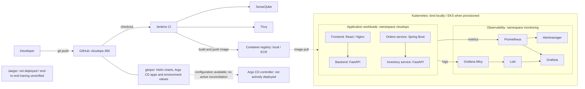
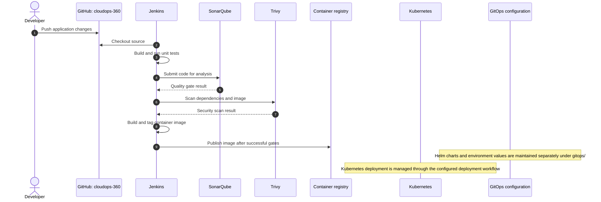
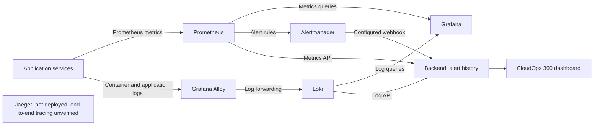
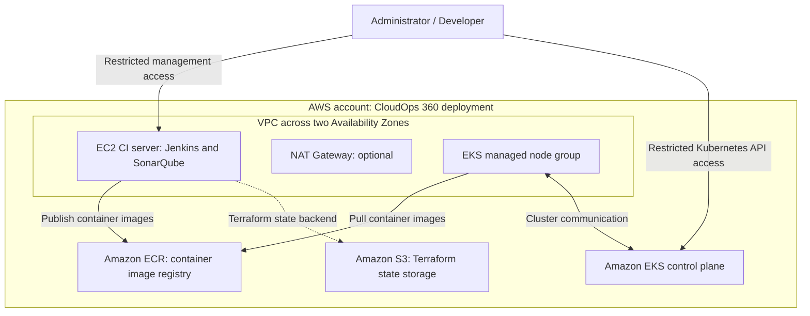

# Architecture

## System overview

The diagram shows the project's application, CI, Kubernetes and observability components. It distinguishes the implemented workflow from integrations that are configured but not actively running.

**Implementation status:**
- Jenkins CI, SonarQube quality checks, Trivy scanning, Kubernetes workloads and the Prometheus/Grafana/Loki/Alloy observability stack have been exercised.
- GitOps Helm charts and Argo CD application definitions are maintained under `gitops/`. Argo CD is not actively reconciling the deployed workloads.
- Jaeger is not deployed in the EKS environment, and end-to-end distributed tracing has not been verified.
- EKS and ECR represent the AWS deployment path; their presence in this architecture does not imply that AWS resources are currently running.

## CI/CD sequence

The CI pipeline validates application changes, performs code quality and security checks, builds container images and publishes successful images to the configured registry.

A failed quality or security gate prevents the pipeline from publishing the affected image. GitOps manifests provide deployment configuration, but Argo CD is not currently performing automatic reconciliation. Do not interpret this diagram as proof of an active automatic GitOps deployment or rollback.

## Observability data flow

The observability stack collects application metrics and logs and makes them available through Grafana. Alertmanager handles configured alert rules and can forward notifications to the backend alert-history integration.

**Implementation notes:**
- Prometheus, Grafana, Loki and Alloy have been exercised in the Kubernetes observability setup.
- Alloy collects and forwards logs to Loki. Log persistence is limited by the current ephemeral storage configuration.
- Alertmanager and backend alert-history integration are configured; verify the relevant alert rules and webhook before claiming end-to-end alert delivery.
- FastAPI services expose Prometheus-compatible metrics, while the Orders service uses Micrometer. Confirm metric names before assuming identical metric behavior across every service.
- Jaeger is not deployed in the EKS environment, and end-to-end distributed tracing has not been verified.

## AWS deployment architecture (planned/reference design)

The following diagram illustrates the intended AWS deployment architecture. It describes the infrastructure design and should not be interpreted as confirmation that all resources are currently provisioned or running.

**AWS implementation notes:**
- Terraform and Ansible configurations describe infrastructure provisioning and configuration management.
- EC2 is intended to host Jenkins and SonarQube for the AWS deployment design.
- EKS provides the managed Kubernetes control plane and worker-node infrastructure.
- ECR is the intended container image registry.
- S3 is intended for remote Terraform state when the remote backend is configured.
- NAT Gateway is an optional networking component and can contribute to ongoing AWS charges.
- Restrict administrative and Kubernetes API access rather than exposing management endpoints publicly.
- Actual resource existence, deployment status, tagging and costs must be verified independently in the AWS account before describing the environment as deployed.