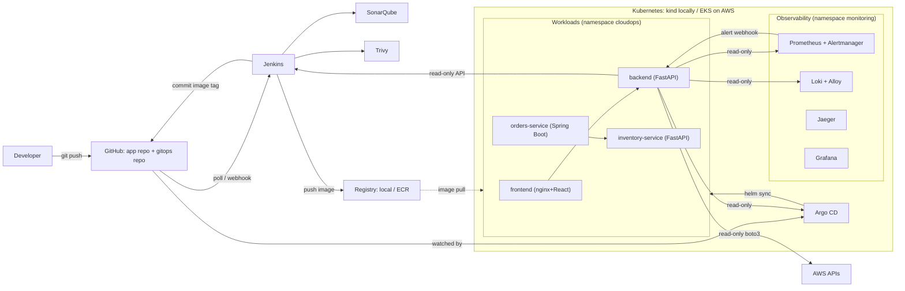
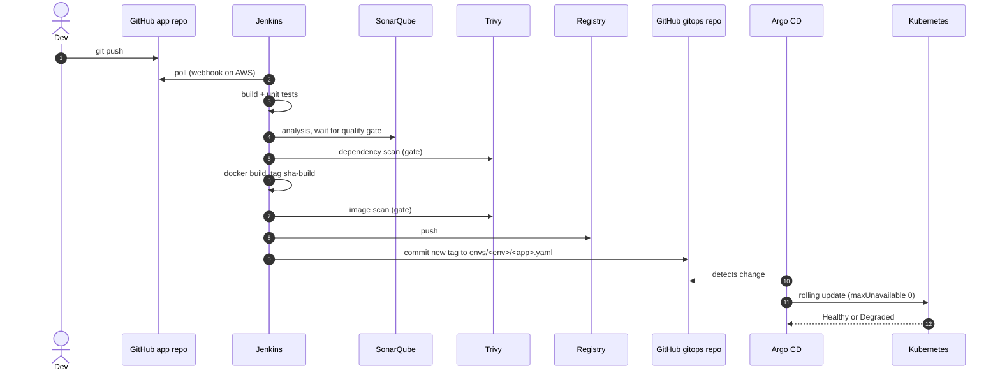
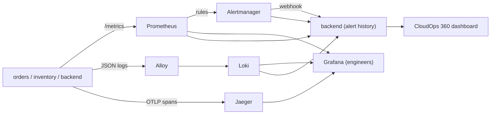
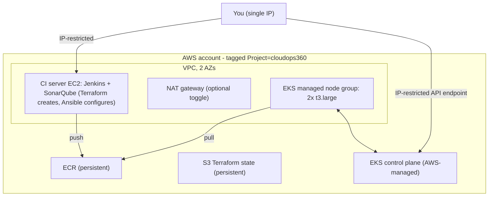

# Architecture

## System overview

## CI/CD sequence

A failed gate stops the pipeline before anything is pushed or deployed. A bad release (never becomes Ready) halts the rollout;
old pods keep serving. Recover with `git revert` in the GitOps repo.

## Observability data flow

All HTTP services expose the same metric name, `http_server_requests_seconds` (Micrometer's name; the FastAPI services imitate it),
so one PromQL expression works for every service.

## AWS deployment (session-based)

